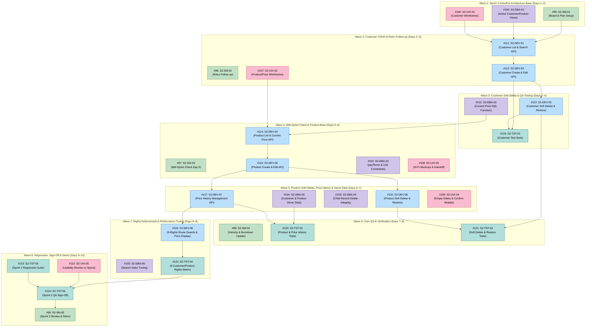

# Hope, Inc. ERP — Sprint 2 Optimal Task Execution Order

> **Sprint Objective:** Deliver Customer Management (Full CRUD, Live Search, Soft Delete/Restore, Stamp), Product Management with Chronological Price History, and enforce all 9 Customer/Product per-action rights on both UI and Server.
> 
> **Core Principle:** Tasks are organized into **Waves**. Tasks within the same Wave touch different files and can be worked on **in parallel**. A Wave must be merged into `main` before the next Wave starts to guarantee **zero merge conflicts**.

---

## 1. File Ownership Rules (Preventing Merge Conflicts)

| Role | Member | Strict File Ownership (Nobody Else Touches These) |
| :--- | :--- | :--- |
| **Scrum Master** | `@HeindrichMacalinao` | `docs/sprints/` (Sprint planning, retro, burndown notes) |
| **DevSecOps** | `@Chrollofuru` | `scripts/migrate/`, `migrations/`, `docs/database/` |
| **Backend Developer** | `@Tysennn` | `server/routes/`, `server/controllers/`, `server/middleware/`, `server/models/` |
| **UI/UX Developer** | `@AlexGavarra` | `src/components/`, `src/pages/`, `src/index.css`, `docs/ui/` |
| **Test Engineer** | `@YthanOrogo` | `docs/testing/`, `tests/` |

---

## 2. Sprint 2 Dependency & Flow Architecture

---

## 3. Wave-by-Wave Execution Plan (Tasks #95 to #124)

### WAVE 1: Sprint 2 Kickoff & Foundation (Days 1–2)
> 💡 **Goal:** Establish sprint board, database active-views, and customer UX layout.

| Order | Issue # | Task ID | Member | Role | Files / Focus | Prerequisites |
| :---: | :---: | :---: | :--- | :--- | :--- | :--- |
| **1** | **[#95]** | `S2-SM-01` | @HeindrichMacalinao | Scrum Master | `docs/sprints/sprint-2-planning.md` & GitHub Board iteration setup. | None |
| **2** | **[#100]** | `S2-DBA-01` | @Chrollofuru | DevSecOps | `migrations/006_active_views_and_indexes.sql` (Creates `v_active_customer` and `v_active_product`). | Sprint 1 merged |
| **3** | **[#106]** | `S2-UIX-01` | @AlexGavarra | UI/UX Developer | `docs/ui/wireframes-customers.md` (Admin view with Status tabs vs User view). | Sprint 1 merged |

*Checkpoint 1:* Once **#100** is merged, DevSecOps informs Backend that database views are ready. Everyone does `git pull origin main`.

---

### WAVE 2: Customer Core CRUD & Wireframes (Days 2–3)
> 💡 **Goal:** Backend implements Customer APIs while UI/UX sketches Product interfaces.

| Order | Issue # | Task ID | Member | Role | Files / Focus | Prerequisites |
| :---: | :---: | :---: | :--- | :--- | :--- | :--- |
| **4** | **[#96]** | `S2-SM-02` | @HeindrichMacalinao | Scrum Master | `docs/sprints/sprint-2-retro-followup.md` (Verifying file ownership). | Wave 1 |
| **5** | **[#111]** | `S2-DEV-01` | @Tysennn | Backend Developer | `server/routes/customers.js` (`GET /api/customers` with search & role filtering). | #100 merged |
| **6** | **[#112]** | `S2-DEV-02` | @Tysennn | Backend Developer | `server/routes/customers.js` (`POST /api/customers` and `PUT /api/customers/:custNo` with `stamp`). | #111 |
| **7** | **[#107]** | `S2-UIX-02` | @AlexGavarra | UI/UX Developer | `docs/ui/wireframes-products.md` (Product list & Price History modal wireframes). | Wave 1 |

*Checkpoint 2:* Once **#112** is merged, Customer Create/Edit is testable. Everyone does `git pull origin main`.

---

### WAVE 3: Customer Soft Delete & Price Query (Days 3–4)
> 💡 **Goal:** Complete Customer lifecycle (Delete/Restore) and test it, while DevSecOps builds price query.

| Order | Issue # | Task ID | Member | Role | Files / Focus | Prerequisites |
| :---: | :---: | :---: | :--- | :--- | :--- | :--- |
| **8** | **[#113]** | `S2-DEV-03` | @Tysennn | Backend Developer | `server/routes/customers.js` (`DELETE` soft delete & `PUT .../restore` for Admin). | #112 merged |
| **9** | **[#101]** | `S2-DBA-02` | @Chrollofuru | DevSecOps | `scripts/queries/current_price.sql` (Query calculating effective price as of date). | #100 merged |
| **10** | **[#119]** | `S2-TST-01` | @YthanOrogo | Test Engineer | `docs/testing/results/customer-test-results.md` (Customer CRUD & role view test cases). | #112 & #113 merged |

*Checkpoint 3:* Customer Management is now fully functional! Everyone does `git pull origin main`.

---

### WAVE 4: Mid-Sprint Check & Product Base (Days 5–6)
> 💡 **Goal:** Evaluate burndown on Day 5 and begin Product Management APIs.

| Order | Issue # | Task ID | Member | Role | Files / Focus | Prerequisites |
| :---: | :---: | :---: | :--- | :--- | :--- | :--- |
| **11** | **[#97]** | `S2-SM-03` | @HeindrichMacalinao | Scrum Master | `docs/sprints/sprint-2-mid-check.md` (Day 5 velocity check). | Wave 3 |
| **12** | **[#102]** | `S2-DBA-03` | @Chrollofuru | DevSecOps | `migrations/007_validation_constraints.sql` (`payTerms` & `unit` check constraints). | Wave 3 |
| **13** | **[#108]** | `S2-UIX-03` | @AlexGavarra | UI/UX Developer | `docs/ui/hifi-customer-product.md` (Pixel-perfect mockups & handoff). | #106 & #107 |
| **14** | **[#114]** | `S2-DEV-04` | @Tysennn | Backend Developer | `server/routes/products.js` (`GET /api/products` using #101 price logic). | #101 merged |
| **15** | **[#115]** | `S2-DEV-05` | @Tysennn | Backend Developer | `server/routes/products.js` (`POST` and `PUT` products with `unit` check). | #114 |

*Checkpoint 4:* Product base listing and creation ready. Everyone does `git pull origin main`.

---

### WAVE 5: Price History, Soft Delete & Demo Data (Days 6–7)
> 💡 **Goal:** Product soft-delete, Price History parent-child dialog API, and seed real demo data.

| Order | Issue # | Task ID | Member | Role | Files / Focus | Prerequisites |
| :---: | :---: | :---: | :--- | :--- | :--- | :--- |
| **16** | **[#116]** | `S2-DEV-06` | @Tysennn | Backend Developer | `server/routes/products.js` (Product soft-delete & restore). | #115 merged |
| **17** | **[#117]** | `S2-DEV-07` | @Tysennn | Backend Developer | `server/routes/prices.js` (Add, edit, delete price by effective date). | #115 merged |
| **18** | **[#103]** | `S2-DBA-04` | @Chrollofuru | DevSecOps | `scripts/verify_referential_integrity.sql` (Verifying child delete blocks). | #102 |
| **19** | **[#104]** | `S2-DBA-05` | @Chrollofuru | DevSecOps | `scripts/migrate/seed_sprint2_demo_data.sql` (C-001–C-005, P-001–P-005, PriceHist). | #102 |
| **20** | **[#109]** | `S2-UIX-04` | @AlexGavarra | UI/UX Developer | `docs/ui/ui-states-error-empty.md` (Empty states & confirm-delete dialogs). | #108 |

*Checkpoint 5:* Both Customer and Product modules have complete database and backend logic. Everyone does `git pull origin main`.

---

### WAVE 6: QA Testing of Products & Soft Delete (Days 7–8)
> 💡 **Goal:** Verify Product pricing calculations, child record safety, and track burndown.

| Order | Issue # | Task ID | Member | Role | Files / Focus | Prerequisites |
| :---: | :---: | :---: | :--- | :--- | :--- | :--- |
| **21** | **[#98]** | `S2-SM-04` | @HeindrichMacalinao | Scrum Master | `docs/sprints/sprint-2-velocity.md` (Burndown metrics leading into Day 8). | Wave 5 |
| **22** | **[#120]** | `S2-TST-02` | @YthanOrogo | Test Engineer | `docs/testing/results/product-price-test-results.md` (Effective date test suite). | #114, #117, #104 |
| **23** | **[#121]** | `S2-TST-03` | @YthanOrogo | Test Engineer | `docs/testing/results/soft-delete-restore-results.md` (Customer/Product soft delete). | #113, #116, #103 |

*Checkpoint 6:* Core testing complete; any found bugs are prioritized before rights enforcement. Everyone does `git pull origin main`.

---

### WAVE 7: Rights Enforcement & Index Tuning (Days 8–9)
> 💡 **Goal:** Lock down server-side security for all 9 rights and optimize SQL performance.

| Order | Issue # | Task ID | Member | Role | Files / Focus | Prerequisites |
| :---: | :---: | :---: | :--- | :--- | :--- | :--- |
| **24** | **[#118]** | `S2-DEV-08` | @Tysennn | Backend Developer | `server/middleware/rbac.js` (Server-side guards for all 9 Customer & Product rights). | #113, #116, #117 |
| **25** | **[#105]** | `S2-DBA-06` | @Chrollofuru | DevSecOps | `docs/database/sprint-2-performance.md` (Search query profiling & index tuning). | #104 |
| **26** | **[#122]** | `S2-TST-04` | @YthanOrogo | Test Engineer | `docs/testing/customer-product-permission-matrix.md` (Testing all 9 rights for HTTP 403). | #118 merged |

*Checkpoint 7:* Security and performance locked down. Everyone does `git pull origin main`.

---

### WAVE 8: Usability Review, Regression & Sprint Sign-Off (Days 9–10)
> 💡 **Goal:** Final quality sign-off, regression suite, and Sprint 2 demonstration.

| Order | Issue # | Task ID | Member | Role | Files / Focus | Prerequisites |
| :---: | :---: | :---: | :--- | :--- | :--- | :--- |
| **27** | **[#110]** | `S2-UIX-05` | @AlexGavarra | UI/UX Developer | `docs/ui/sprint-2-usability-audit.md` (Comparing built UI with Figures 9–14). | Active UI |
| **28** | **[#123]** | `S2-TST-05` | @YthanOrogo | Test Engineer | `docs/testing/sprint-2-regression.md` (Verifying Sprint 1 Auth & User Mgmt). | All DEV tasks |
| **29** | **[#124]** | `S2-TST-06` | @YthanOrogo | Test Engineer | `docs/testing/sprint-2-signoff.md` (Official QA Sign-Off report). | #120–#123 |
| **30** | **[#99]** | `S2-SM-05` | @HeindrichMacalinao | Scrum Master | `docs/sprints/sprint-2-retrospective.md` (Live demo & midterm report). | All 29 PRs merged |
