# Hope, Inc. ERP — Sprint 3 Optimal Task Execution Order

> **Sprint Objective:** Deliver the Human Resources module comprising lookup entities (`JOB`, `DEPARTMENT`), Employee Master records (`EMPLOYEE`), and career progression timeline (`JOBHISTORY`). Enforce full CRUD, live search, soft delete/restore, audit stamps, Data Privacy Act of 2012 (RA 10173) salary privacy gating, and all 13 HR granular rights across UI and Server.
>
> **Core Principle:** Tasks are organized into **Waves**. Tasks within the same Wave touch different files and can be worked on **in parallel**. A Wave must be merged into `main` before dependent tasks begin to guarantee **zero merge conflicts**.
>
> **Mandatory UI/UX Standard:** In accordance with sprint guidelines, all UI/UX deliverables must be **working Next.js/React UI files** (`src/components/`, `src/app/`) wired to live backend API routes and the database—not static mockups.

---

## 1. File Ownership Rules (Preventing Merge Conflicts)

| Role | Member | Strict File Ownership (Nobody Else Touches These) |
| :--- | :--- | :--- |
| **Scrum Master** | `@HeindrichMacalinao` | `docs/sprints/` (Sprint planning, mid-checks, burndown, retro) |
| **DevSecOps** | `@Chrollofuru` | `migrations/`, `db/`, `docs/database/` |
| **Backend Developer** | `@Tysennn` | `src/routes/`, `src/controllers/`, `src/middleware/`, `src/models/` |
| **UI/UX Developer** | `@AlexGavarra` | `src/components/`, `src/app/`, `docs/ui/` *(Working interactive UI files)* |
| **Test Engineer** | `@YthanOrogo` | `tests/`, `docs/testing/` |

---

## 2. Sprint 3 Dependency & Flow Architecture

```mermaid
flowchart TD
    classDef sm fill:#c2e0c6,stroke:#2e7d32,color:#000
    classDef dba fill:#d1c4e9,stroke:#512da8,color:#000
    classDef dev fill:#bbdefb,stroke:#1565c0,color:#000
    classDef uix fill:#f8bbd0,stroke:#c2185b,color:#000
    classDef tst fill:#b2dfdb,stroke:#00695c,color:#000

    subgraph W1["Wave 1: Sprint 3 Kickoff & Lookup Architecture (Days 1–2)"]
        SM1["#171: S3-SM-01<br>(Board & Plan Setup)"]:::sm
        DBA1["#176: S3-DBA-01<br>(Active HR Views & Indexes)"]:::dba
        UIX1["#190: S3-UIX-01<br>(Working HR Nav Shell)"]:::uix
    end

    subgraph W2["Wave 2: Lookup Tables CRUD & Retro Follow-up (Days 2–3)"]
        SM2["#172: S3-SM-02<br>(Retro Follow-up)"]:::sm
        DEV1["#182: S3-DEV-01<br>(Jobs List & Search API)"]:::dev
        DEV2["#183: S3-DEV-02<br>(Jobs Mutation API)"]:::dev
        DEV3["#184: S3-DEV-03<br>(Departments CRUD API)"]:::dev
    end

    subgraph W3["Wave 3: Lookup QA, Current Job Query & Working UI (Days 3–4)"]
        DBA2["#177: S3-DBA-02<br>(Current Job SQL Query)"]:::dba
        UIX2["#191: S3-UIX-02<br>(Working Jobs/Depts UI)"]:::uix
        TST1["#195: S3-TST-01<br>(Jobs/Depts Test Suite)"]:::tst
    end

    subgraph W4["Wave 4: Mid-Sprint Check & Employee Master Base (Days 5–6)"]
        SM3["#173: S3-SM-03<br>(Mid-Sprint Check Day 5)"]:::sm
        DBA3["#178: S3-DBA-03<br>(HR Domain Constraints)"]:::dba
        DEV4["#185: S3-DEV-04<br>(Employee List & Search API)"]:::dev
        DEV5["#186: S3-DEV-05<br>(Employee Create/Edit API)"]:::dev
    end

    subgraph W5["Wave 5: Employee Soft Delete & Working UI (Days 6–7)"]
        DEV6["#187: S3-DEV-06<br>(Employee Delete/Restore API)"]:::dev
        DBA4["#179: S3-DBA-04<br>(Child Delete Protection)"]:::dba
        UIX3["#192: S3-UIX-03<br>(Working Employee Master UI)"]:::uix
        TST2["#196: S3-TST-02<br>(Employee CRUD Test Suite)"]:::tst
    end

    subgraph W6["Wave 6: Job History Timeline & Working Modal Dialog (Days 7–8)"]
        DBA5["#180: S3-DBA-05<br>(Seed HR Demo Data)"]:::dba
        DEV7["#188: S3-DEV-07<br>(Job History Timeline API)"]:::dev
        UIX4["#193: S3-UIX-04<br>(Working Job History Modal UI)"]:::uix
        TST3["#197: S3-TST-03<br>(Job History Test Suite)"]:::tst
    end

    subgraph W7["Wave 7: RA 10173 Salary Privacy & 13 HR Rights (Days 8–9)"]
        SM4["#174: S3-SM-04<br>(Velocity & Burndown)"]:::sm
        DBA6["#181: S3-DBA-06<br>(HR Performance Tuning)"]:::dba
        DEV8["#189: S3-DEV-08<br>(13 Rights & Salary Gating)"]:::dev
        UIX5["#194: S3-UIX-05<br>(Working Privacy UI & Polish)"]:::uix
        TST4["#198: S3-TST-04<br>(13-Rights Matrix Testing)"]:::tst
    end

    subgraph W8["Wave 8: Regression, Sign-Off & Demo (Days 9–10)"]
        TST5["#199: S3-TST-05<br>(S1 & S2 Regression Suite)"]:::tst
        TST6["#200: S3-TST-06<br>(Sprint 3 QA Sign-Off)"]:::tst
        SM5["#175: S3-SM-05<br>(Sprint 3 Review & Retro)"]:::sm
    end

    %% Key Dependencies
    SM1 --> DEV1
    DBA1 --> DEV1
    UIX1 --> UIX2
    DEV1 --> DEV2
    DEV2 --> TST1
    DEV3 --> TST1
    DEV2 --> UIX2
    DEV3 --> UIX2
    DBA1 --> DEV4
    DBA3 --> DEV5
    DEV4 --> DEV5
    DEV5 --> DEV6
    DEV5 --> UIX3
    DEV6 --> UIX3
    DEV5 --> TST2
    DEV6 --> TST2
    DBA2 --> DEV7
    DBA5 --> DEV7
    DEV7 --> UIX4
    DEV7 --> TST3
    DEV8 --> UIX5
    DEV8 --> TST4
    UIX5 --> TST6
    TST4 --> TST6
    TST5 --> TST6
    TST6 --> SM5
```

---

## 3. Wave-by-Wave Execution Plan (Tasks #171 to #200)

### WAVE 1: Sprint 3 Kickoff & Lookup Architecture (Days 1–2)
> 💡 **Goal:** Initialize sprint board, database active views for HR tables, and establish working HR tab navigation shell.

| Order | Issue # | Task ID | Member | Role | Files / Focus | Prerequisites |
| :---: | :---: | :---: | :--- | :--- | :--- | :--- |
| **1** | **[#171]** | `S3-SM-01` | @HeindrichMacalinao | Scrum Master | `docs/sprints/sprint-3-planning.md` & GitHub Board iteration setup. | None |
| **2** | **[#176]** | `S3-DBA-01` | @Chrollofuru | DevSecOps | `migrations/` & `db/migrations/` (Creates `v_active_employees`, `v_active_jobs`, `v_active_departments`, `v_active_jobhistory`). | Sprint 2 merged |
| **3** | **[#190]** | `S3-UIX-01` | @AlexGavarra | UI/UX Developer | `src/components/HumanResourcesManagement.tsx` & `src/app/dashboard/page.tsx` (Working HR shell with tabbed navigation: Employees, Jobs, Departments). | Sprint 2 merged |

*Checkpoint 1:* Once **#176** is merged, DevSecOps notifies Backend that database views and indexes are ready. Team pulls `main`.

---

### WAVE 2: Lookup Tables CRUD & Retro Follow-up (Days 2–3)
> 💡 **Goal:** Backend delivers full CRUD APIs for Job and Department lookup tables; Scrum Master enforces retro improvements.

| Order | Issue # | Task ID | Member | Role | Files / Focus | Prerequisites |
| :---: | :---: | :---: | :--- | :--- | :--- | :--- |
| **4** | **[#172]** | `S3-SM-02` | @HeindrichMacalinao | Scrum Master | `docs/sprints/sprint-3-retro-followup.md` (Verifying file ownership & UI working code requirement). | Wave 1 |
| **5** | **[#182]** | `S3-DEV-01` | @Tysennn | Backend Developer | `src/routes/jobs.js` (`GET /api/hr/jobs` with search, status filtering & role visibility). | #176 merged |
| **6** | **[#183]** | `S3-DEV-02` | @Tysennn | Backend Developer | `src/routes/jobs.js` (`POST`, `PUT`, `DELETE`, `POST /restore` with audit stamp generation). | #182 |
| **7** | **[#184]** | `S3-DEV-03` | @Tysennn | Backend Developer | `src/routes/departments.js` (Full Department CRUD, search, soft delete & restore with audit stamp). | #176 merged |

*Checkpoint 2:* Lookup endpoints are live and testable. Team pulls `main`.

---

### WAVE 3: Lookup QA, Current Job Query & Working UI (Days 3–4)
> 💡 **Goal:** Connect working UI components for Jobs & Departments to live backend APIs, execute QA test suite, and prepare analytical current-job query.

| Order | Issue # | Task ID | Member | Role | Files / Focus | Prerequisites |
| :---: | :---: | :---: | :--- | :--- | :--- | :--- |
| **8** | **[#177]** | `S3-DBA-02` | @Chrollofuru | DevSecOps | `db/verify/verify_current_job.sql` (Analytical SQL query/view for latest employee job/dept as of date). | #176 merged |
| **9** | **[#191]** | `S3-UIX-02` | @AlexGavarra | UI/UX Developer | `src/components/HumanResourcesManagement.tsx` (Working Jobs & Departments tab components with live data tables, + Add modals, Edit modals, and Soft Delete/Restore). | #183, #184 |
| **10** | **[#195]** | `S3-TST-01` | @YthanOrogo | Test Engineer | `tests/hr-lookups.test.js` & `docs/testing/results/hr-lookups-test-results.md` (Automated & manual test suite for Jobs and Departments). | #183, #184 |

*Checkpoint 3:* Jobs and Departments lookup modules are 100% complete, verified on UI and server. Team pulls `main`.

---

### WAVE 4: Mid-Sprint Check & Employee Master Base (Days 5–6)
> 💡 **Goal:** Evaluate Day 5 velocity, establish HR database domain constraints, and build Employee Master query/create/edit endpoints.

| Order | Issue # | Task ID | Member | Role | Files / Focus | Prerequisites |
| :---: | :---: | :---: | :--- | :--- | :--- | :--- |
| **11** | **[#173]** | `S3-SM-03` | @HeindrichMacalinao | Scrum Master | `docs/sprints/sprint-3-mid-check.md` (Day 5 burnup evaluation & impediment resolution). | Wave 3 |
| **12** | **[#178]** | `S3-DBA-03` | @Chrollofuru | DevSecOps | `migrations/` (`gender` check, `sepDate >= hireDate` constraint, positive salary domain checks). | Wave 3 |
| **13** | **[#185]** | `S3-DEV-04` | @Tysennn | Backend Developer | `src/routes/employees.js` (`GET /api/hr/employees` with status tabs, search & role column visibility). | #176 |
| **14** | **[#186]** | `S3-DEV-05` | @Tysennn | Backend Developer | `src/routes/employees.js` (`POST` and `PUT` with date validations `sepDate >= hireDate` and stamp generation). | #185 |

*Checkpoint 4:* Employee profile base APIs ready. Team pulls `main`.

---

### WAVE 5: Employee Soft Delete & Working UI (Days 6–7)
> 💡 **Goal:** Complete employee lifecycle (soft delete/restore), deliver working Employee Master UI component, and enforce child-delete protection.

| Order | Issue # | Task ID | Member | Role | Files / Focus | Prerequisites |
| :---: | :---: | :---: | :--- | :--- | :--- | :--- |
| **15** | **[#187]** | `S3-DEV-06` | @Tysennn | Backend Developer | `src/routes/employees.js` (`DELETE` soft delete & `POST /restore` with `sepDate` vs `status` separation). | #186 |
| **16** | **[#179]** | `S3-DBA-04` | @Chrollofuru | DevSecOps | `db/verify/verify_hr_referential_integrity.sql` (Preventing deletion of jobs/departments with active staff). | #178 |
| **17** | **[#192]** | `S3-UIX-03` | @AlexGavarra | UI/UX Developer | `src/components/HumanResourcesManagement.tsx` (Working live Employee table, search filter, Add/Edit modal with client-side date checks, soft-delete & restore). | #186, #187 |
| **18** | **[#196]** | `S3-TST-02` | @YthanOrogo | Test Engineer | `tests/employee-crud.test.js` & `docs/testing/results/employee-test-results.md` (Testing CRUD, date validation, and `sepDate` vs soft-delete logic). | #186, #187 |

*Checkpoint 5:* Employee Master management fully functional on frontend and backend. Team pulls `main`.

---

### WAVE 6: Job History Timeline & Working Modal Dialog (Days 7–8)
> 💡 **Goal:** Deliver Job History timeline API (composite PK), working Next.js Job History modal component, and seed official HR demo dataset.

| Order | Issue # | Task ID | Member | Role | Files / Focus | Prerequisites |
| :---: | :---: | :---: | :--- | :--- | :--- | :--- |
| **19** | **[#180]** | `S3-DBA-05` | @Chrollofuru | DevSecOps | `db/seeds/004_human_resources_seed.sql` (Seed E-001–E-004, J-001–J-004, D-001–D-004, and salary history). | #179 |
| **20** | **[#188]** | `S3-DEV-07` | @Tysennn | Backend Developer | `src/routes/jobHistory.js` (Promotion/transfer CRUD with composite key `empNo + jobCode + effDate`). | #177, #186 |
| **21** | **[#193]** | `S3-UIX-04` | @AlexGavarra | UI/UX Developer | `src/components/JobHistoryModal.tsx` (Working modal connected to live API: career timeline, + Add History sub-modal with Job/Dept dropdowns, salary display). | #188 |
| **22** | **[#197]** | `S3-TST-03` | @YthanOrogo | Test Engineer | `tests/job-history.test.js` & `docs/testing/results/job-history-test-results.md` (Testing composite key, multiple tenures, and salary progression). | #188 |

*Checkpoint 6:* Job History and career tracking fully integrated. Team pulls `main`.

---

### WAVE 7: RA 10173 Salary Privacy & 13 HR Rights (Days 8–9)
> 💡 **Goal:** Enforce Data Privacy Act (RA 10173) salary masking and all 13 HR per-action rights on server and UI, and tune SQL performance.

| Order | Issue # | Task ID | Member | Role | Files / Focus | Prerequisites |
| :---: | :---: | :---: | :--- | :--- | :--- | :--- |
| **23** | **[#174]** | `S3-SM-04` | @HeindrichMacalinao | Scrum Master | `docs/sprints/sprint-3-velocity.md` (Sprint 3 burndown and review credit audit). | Wave 6 |
| **24** | **[#181]** | `S3-DBA-06` | @Chrollofuru | DevSecOps | `docs/database/sprint-3-performance.md` (EXPLAIN query profiling & index tuning for HR queries). | #180 |
| **25** | **[#189]** | `S3-DEV-08` | @Tysennn | Backend Developer | `src/middleware/rbac.js` (Route guards for all 13 HR rights & server-side salary masking without `jobhistory.view`). | #187, #188 |
| **26** | **[#194]** | `S3-UIX-05` | @AlexGavarra | UI/UX Developer | `src/components/HumanResourcesManagement.tsx` & `src/components/JobHistoryModal.tsx` (Working client-side 13-rights button hiding, RA 10173 salary shielding & loading/empty states). | #189, #193 |
| **27** | **[#198]** | `S3-TST-04` | @YthanOrogo | Test Engineer | `docs/testing/hr-permission-matrix.md` (Verifying all 13 HR rights and direct API bypass blocking for HTTP 403). | #189, #194 |

*Checkpoint 7:* Security, Data Privacy Act compliance, and performance verified. Team pulls `main`.

---

### WAVE 8: Regression, Sign-Off & Demo (Days 9–10)
> 💡 **Goal:** Execute full system regression, achieve QA quality sign-off, and host Sprint 3 live review and retrospective.

| Order | Issue # | Task ID | Member | Role | Files / Focus | Prerequisites |
| :---: | :---: | :---: | :--- | :--- | :--- | :--- |
| **28** | **[#199]** | `S3-TST-05` | @YthanOrogo | Test Engineer | `docs/testing/sprint-3-regression.md` (Verifying Sprint 1 Auth/Users & Sprint 2 Customers/Products). | All DEV tasks |
| **29** | **[#200]** | `S3-TST-06` | @YthanOrogo | Test Engineer | `docs/testing/sprint-3-signoff.md` (Official Sprint 3 QA Quality Sign-Off report). | #195–#199 |
| **30** | **[#175]** | `S3-SM-05` | @HeindrichMacalinao | Scrum Master | `docs/sprints/sprint-3-retrospective.md` (Live demo coordination & retrospective report). | All 29 PRs merged |

---

## 4. Sprint 3 Task Plan & Pull Request Tracking Spreadsheet

| Task ID | Issue | Role | Member | Pull Request / Planned Delivery | Target Due | Status |
| :--- | :---: | :--- | :--- | :--- | :---: | :---: |
| `S3-SM-01` | [#171](https://github.com/HeindrichMacalinao/AmbatuPull/issues/171) | Scrum Master | @HeindrichMacalinao | [PR #201](https://github.com/HeindrichMacalinao/AmbatuPull/pull/201) — Sprint 3 Planning Notes & Board Setup | Day 1 | **Merged** |
| `S3-DBA-01` | [#176](https://github.com/HeindrichMacalinao/AmbatuPull/issues/176) | DevSecOps | @Chrollofuru | [PR #203](https://github.com/HeindrichMacalinao/AmbatuPull/pull/203) — Active HR Views and Indexes | Day 1 | **Merged** |
| `S3-UIX-01` | [#190](https://github.com/HeindrichMacalinao/AmbatuPull/issues/190) | UI/UX Dev | @AlexGavarra | [PR #202](https://github.com/HeindrichMacalinao/AmbatuPull/pull/202) — Working HR Nav & Module Shell Component | Day 2 | **Merged** |
| `S3-SM-02` | [#172](https://github.com/HeindrichMacalinao/AmbatuPull/issues/172) | Scrum Master | @HeindrichMacalinao | [PR #204](https://github.com/HeindrichMacalinao/AmbatuPull/pull/204) — Follow Up Sprint 2 Retrospective Action Items | Day 2 | **Merged** |
| `S3-DEV-01` | [#182](https://github.com/HeindrichMacalinao/AmbatuPull/issues/182) | Backend Dev | @Tysennn | [PR #205](https://github.com/HeindrichMacalinao/AmbatuPull/pull/205) — Jobs Lookup API: List & Search Jobs | Day 2 | **Merged** |
| `S3-DEV-02` | [#183](https://github.com/HeindrichMacalinao/AmbatuPull/issues/183) | Backend Dev | @Tysennn | [PR #206](https://github.com/HeindrichMacalinao/AmbatuPull/pull/206) — Jobs Mutation API: Create, Edit, Soft Delete & Restore | Day 3 | **Merged** |
| `S3-DEV-03` | [#184](https://github.com/HeindrichMacalinao/AmbatuPull/issues/184) | Backend Dev | @Tysennn | [PR #207](https://github.com/HeindrichMacalinao/AmbatuPull/pull/207) — Departments Management API: Full CRUD & Search | Day 3 | **Merged** |
| `S3-DBA-02` | [#177](https://github.com/HeindrichMacalinao/AmbatuPull/issues/177) | DevSecOps | @Chrollofuru | [PR #214](https://github.com/HeindrichMacalinao/AmbatuPull/pull/214) — SQL Analytical Query: Current Employee Position | Day 3 | **Merged** |
| `S3-UIX-02` | [#191](https://github.com/HeindrichMacalinao/AmbatuPull/issues/191) | UI/UX Dev | @AlexGavarra | [PR #213](https://github.com/HeindrichMacalinao/AmbatuPull/pull/213) — Working Jobs & Departments Management UI | Day 4 | **Merged** |
| `S3-TST-01` | [#195](https://github.com/HeindrichMacalinao/AmbatuPull/issues/195) | Test Engineer | @YthanOrogo | [PR #222](https://github.com/HeindrichMacalinao/AmbatuPull/pull/222) — Test Suite: Jobs & Departments Lookups CRUD | Day 4 | **Merged** |
| `S3-SM-03` | [#173](https://github.com/HeindrichMacalinao/AmbatuPull/issues/173) | Scrum Master | @HeindrichMacalinao | Mid-Sprint Check Notes, Impediment Log & Blocker Removal | Day 5 | **In Review** |
| `S3-DBA-03` | [#178](https://github.com/HeindrichMacalinao/AmbatuPull/issues/178) | DevSecOps | @Chrollofuru | [PR #215](https://github.com/HeindrichMacalinao/AmbatuPull/pull/215) — Database Constraints: Employee Gender, sepDate & Salary | Day 5 | **Merged** |
| `S3-DEV-04` | [#185](https://github.com/HeindrichMacalinao/AmbatuPull/issues/185) | Backend Dev | @Tysennn | [PR #208](https://github.com/HeindrichMacalinao/AmbatuPull/pull/208) — Employees List & Search API with Status Tabs | Day 4 | **Merged** |
| `S3-DEV-05` | [#186](https://github.com/HeindrichMacalinao/AmbatuPull/issues/186) | Backend Dev | @Tysennn | [PR #209](https://github.com/HeindrichMacalinao/AmbatuPull/pull/209) — Employees Create & Edit API with Profile Validation | Day 5 | **Merged** |
| `S3-DEV-06` | [#187](https://github.com/HeindrichMacalinao/AmbatuPull/issues/187) | Backend Dev | @Tysennn | [PR #210](https://github.com/HeindrichMacalinao/AmbatuPull/pull/210) — Employees Soft Delete & Admin Restore API | Day 6 | **Merged** |
| `S3-DBA-04` | [#179](https://github.com/HeindrichMacalinao/AmbatuPull/issues/179) | DevSecOps | @Chrollofuru | [PR #217](https://github.com/HeindrichMacalinao/AmbatuPull/pull/217) — Referential Integrity & Child-Record Protection | Day 6 | **Merged** |
| `S3-UIX-03` | [#192](https://github.com/HeindrichMacalinao/AmbatuPull/issues/192) | UI/UX Dev | @AlexGavarra | [PR #216](https://github.com/HeindrichMacalinao/AmbatuPull/pull/216) — Working Employee Master Registry UI Component | Day 6 | **Merged** |
| `S3-TST-02` | [#196](https://github.com/HeindrichMacalinao/AmbatuPull/issues/196) | Test Engineer | @YthanOrogo | [PR #223](https://github.com/HeindrichMacalinao/AmbatuPull/pull/223) — Test Suite: Employee Master Management CRUD | Day 6 | **Merged** |
| `S3-DBA-05` | [#180](https://github.com/HeindrichMacalinao/AmbatuPull/issues/180) | DevSecOps | @Chrollofuru | [PR #218](https://github.com/HeindrichMacalinao/AmbatuPull/pull/218) — Seed Demo Data: Comprehensive HR Records | Day 7 | **Merged** |
| `S3-DEV-07` | [#188](https://github.com/HeindrichMacalinao/AmbatuPull/issues/188) | Backend Dev | @Tysennn | [PR #211](https://github.com/HeindrichMacalinao/AmbatuPull/pull/211) — Job History Timeline API: Composite Key CRUD | Day 7 | **Merged** |
| `S3-UIX-04` | [#193](https://github.com/HeindrichMacalinao/AmbatuPull/issues/193) | UI/UX Dev | @AlexGavarra | [PR #220](https://github.com/HeindrichMacalinao/AmbatuPull/pull/220) — Working Job History & Career Progression Modal Dialog | Day 7 | **Merged** |
| `S3-TST-03` | [#197](https://github.com/HeindrichMacalinao/AmbatuPull/issues/197) | Test Engineer | @YthanOrogo | [PR #224](https://github.com/HeindrichMacalinao/AmbatuPull/pull/224) — Test Suite: Job History Timeline & Progression | Day 7 | **Merged** |
| `S3-SM-04` | [#174](https://github.com/HeindrichMacalinao/AmbatuPull/issues/174) | Scrum Master | @HeindrichMacalinao | Update Sprint 3 Velocity, Burndown Metrics & PR Quotas | Day 8 | Scheduled |
| `S3-DBA-06` | [#181](https://github.com/HeindrichMacalinao/AmbatuPull/issues/181) | DevSecOps | @Chrollofuru | [PR #219](https://github.com/HeindrichMacalinao/AmbatuPull/pull/219) — Database Performance Check & Index Tuning | Day 8 | **Merged** |
| `S3-DEV-08` | [#189](https://github.com/HeindrichMacalinao/AmbatuPull/issues/189) | Backend Dev | @Tysennn | [PR #212](https://github.com/HeindrichMacalinao/AmbatuPull/pull/212) — RA 10173 Salary Privacy & 13 HR Route Guards | Day 8 | **Merged** |
| `S3-UIX-05` | [#194](https://github.com/HeindrichMacalinao/AmbatuPull/issues/194) | UI/UX Dev | @AlexGavarra | [PR #221](https://github.com/HeindrichMacalinao/AmbatuPull/pull/221) — Working RA 10173 Privacy Gating & 13-Rights Polish | Day 9 | **Merged** |
| `S3-TST-04` | [#198](https://github.com/HeindrichMacalinao/AmbatuPull/issues/198) | Test Engineer | @YthanOrogo | [PR #225](https://github.com/HeindrichMacalinao/AmbatuPull/pull/225) — Permission Matrix Testing: 13 HR Rights & Privacy | Day 8 | **Merged** |
| `S3-TST-05` | [#199](https://github.com/HeindrichMacalinao/AmbatuPull/issues/199) | Test Engineer | @YthanOrogo | [PR #226](https://github.com/HeindrichMacalinao/AmbatuPull/pull/226) — Regression Test Suite: Verify S1 & S2 Deliverables | Day 9 | **Merged** |
| `S3-TST-06` | [#200](https://github.com/HeindrichMacalinao/AmbatuPull/issues/200) | Test Engineer | @YthanOrogo | [PR #227](https://github.com/HeindrichMacalinao/AmbatuPull/pull/227) — HR Defect Triage & Sprint 3 Quality Sign-Off | Day 10 | **Merged** |
| `S3-SM-05` | [#175](https://github.com/HeindrichMacalinao/AmbatuPull/issues/175) | Scrum Master | @HeindrichMacalinao | Sprint 3 Review, Live Demo Coordination & Retrospective Report | Day 10 | Scheduled |
