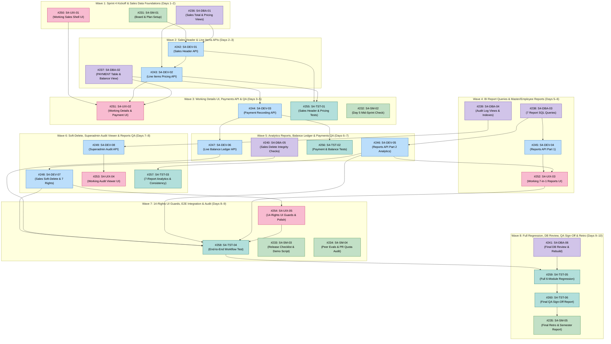

# Hope, Inc. ERP — Sprint 4 Optimal Task Execution Order & Dependency Architecture

> **Sprint Objective:** Deliver the Sales module (auto-numbered transaction headers `SALES`, line items `SALESDETAIL` with historical pricing as of sale date, payments ledger `PAYMENT`, and live balance calculation `balance = total - sum(payments)`), all 7 Executive Business Intelligence (BI) Reports (with date range & Top N filtering, Print & Save as PDF), the Superadmin Audit Log Viewer, and enforce all 14 remaining per-action rights (7 Sales + 7 Reports) across UI and server. Conclude with full end-to-end integration testing, full 6-module regression, and the final production QA sign-off.
>
> **Core Principle:** Tasks are organized into **Waves**. Tasks within the same Wave touch distinct, isolated files and can be executed in parallel. Each Wave must be reviewed, tested, and merged into `main` before dependent tasks begin to guarantee **zero merge conflicts**.
>
> **Mandatory UI/UX Standard:** In accordance with project requirements, all UI/UX deliverables must be **working Next.js/React frontend code** (`src/components/`, `src/app/`) connected to live backend API routes and the database—not static mockups or wireframe markdown.

---

## 1. File Ownership Rules (Preventing Merge Conflicts)

| Role | Member | Strict File Ownership (Nobody Else Touches These) |
| :--- | :--- | :--- |
| **Scrum Master** | `@HeindrichMacalinao` | `docs/sprints/` (Sprint planning, retro, burndown, release checklists) |
| **DevSecOps** | `@Chrollofuru` | `migrations/`, `db/`, `docs/database/` |
| **Backend Developer** | `@Tysennn` | `src/routes/`, `src/controllers/`, `src/middleware/`, `src/models/` |
| **UI/UX Developer** | `@AlexGavarra` | `src/components/`, `src/app/`, `docs/ui/` *(Working interactive UI files)* |
| **Test Engineer** | `@YthanOrogo` | `tests/`, `docs/testing/` |

---

## 2. Sprint 4 Dependency & Flow Architecture

---

## 3. Wave-by-Wave Execution Plan (Tasks #231 to #260)

### WAVE 1: Sprint 4 Kickoff & Sales Data Foundations (Days 1–2)
> 💡 **Goal:** Initialize sprint board, establish database views for historical sales line pricing (`v_saleline`) and live transaction totals (`v_sales_summary`), and mount the working Sales Management UI shell in the dashboard.

| Order | Issue # | Task ID | Member | Role | Files / Focus | Prerequisites |
| :---: | :---: | :---: | :--- | :--- | :--- | :--- |
| **1** | **[#231](https://github.com/HeindrichMacalinao/AmbatuPull/issues/231)** | `S4-SM-01` | @HeindrichMacalinao | Scrum Master | `docs/sprints/sprint-4-planning.md` & GitHub Project board setup. | None |
| **2** | **[#236](https://github.com/HeindrichMacalinao/AmbatuPull/issues/236)** | `S4-DBA-01` | @Chrollofuru | DevSecOps | `migrations/` & `db/migrations/` (Creates `v_saleline` and sales summary calculation queries). | Sprint 3 merged |
| **3** | **[#250](https://github.com/HeindrichMacalinao/AmbatuPull/issues/250)** | `S4-UIX-01` | @AlexGavarra | UI/UX Developer | `src/components/SalesManagement.tsx` mounted in `src/app/dashboard/page.tsx` (Working Sales shell, live table & header form). | Sprint 3 merged |

*Checkpoint 1:* DevSecOps merges pricing view and query helper; UI/UX mounts working sales shell in dashboard. Team pulls `main`.

---

### WAVE 2: Sales Header & Line Items APIs (Days 2–3)
> 💡 **Goal:** Deliver Sales header creation API with auto-numbering (`T-###`) and line items master-detail API with chronological price lookup; establish `PAYMENT` ledger table.

| Order | Issue # | Task ID | Member | Role | Files / Focus | Prerequisites |
| :---: | :---: | :---: | :--- | :--- | :--- | :--- |
| **4** | **[#242](https://github.com/HeindrichMacalinao/AmbatuPull/issues/242)** | `S4-DEV-01` | @Tysennn | Backend Developer | `src/routes/sales.js` (`GET /api/sales` with search, role views, and `POST /api/sales` with auto-numbered `T-###`). | #236 merged |
| **5** | **[#243](https://github.com/HeindrichMacalinao/AmbatuPull/issues/243)** | `S4-DEV-02` | @Tysennn | Backend Developer | `src/routes/sales.js` (Line items CRUD on `/api/sales/:transNo/details` with dynamic price lookup as of `salesDate`). | #242, #236 |
| **6** | **[#237](https://github.com/HeindrichMacalinao/AmbatuPull/issues/237)** | `S4-DBA-02` | @Chrollofuru | DevSecOps | `migrations/` & `db/migrations/` (`PAYMENT` table schema with `ORNo`, `amount > 0` constraint, and `v_sales_balance` view). | Wave 1 |

*Checkpoint 2:* Sales master-detail creation and line pricing live. Payment schema established. Team pulls `main`.

---

### WAVE 3: Working Details UI, Payments API & QA (Days 3–5)
> 💡 **Goal:** Deliver working Next.js/React modal dialogs for Sale Details and Payment recording; implement Payment API and execute Sales QA test suite.

| Order | Issue # | Task ID | Member | Role | Files / Focus | Prerequisites |
| :---: | :---: | :---: | :--- | :--- | :--- | :--- |
| **7** | **[#251](https://github.com/HeindrichMacalinao/AmbatuPull/issues/251)** | `S4-UIX-02` | @AlexGavarra | UI/UX Developer | `src/components/SaleDetailsModal.tsx` & `src/components/PaymentModal.tsx` (Working master-detail line items & payment entry modals). | #243, #237 |
| **8** | **[#244](https://github.com/HeindrichMacalinao/AmbatuPull/issues/244)** | `S4-DEV-03` | @Tysennn | Backend Developer | `src/routes/payments.js` (`POST /api/payments` with `ORNo`, validation and payment history). | #237, #242 |
| **9** | **[#255](https://github.com/HeindrichMacalinao/AmbatuPull/issues/255)** | `S4-TST-01` | @YthanOrogo | Test Engineer | `tests/sales.test.js` & `docs/testing/results/sales-test-results.md` (Sales header CRUD, auto-numbering, and price-as-of-date tests). | #242, #243 |
| **10** | **[#232](https://github.com/HeindrichMacalinao/AmbatuPull/issues/232)** | `S4-SM-02` | @HeindrichMacalinao | Scrum Master | `docs/sprints/sprint-4-mid-check.md` (Day 5 burnup evaluation & impediment log). | Wave 2 |

*Checkpoint 3:* Sales transactions and line pricing fully tested; payment entry live and connected to modal. Team pulls `main`.

---

### WAVE 4: BI Report Queries & Master/Employee Reports (Days 5–6)
> 💡 **Goal:** Implement optimized SQL queries for all 7 reports; deliver backend endpoints for Part 1 reports (Product Master, Active/All Employees, Job History); build working 7-in-1 Reports UI shell with Print/PDF export.

| Order | Issue # | Task ID | Member | Role | Files / Focus | Prerequisites |
| :---: | :---: | :---: | :--- | :--- | :--- | :--- |
| **11** | **[#238](https://github.com/HeindrichMacalinao/AmbatuPull/issues/238)** | `S4-DBA-03` | @Chrollofuru | DevSecOps | `db/reports/` & `db/verify/` (Optimized SQL queries for all 7 BI reports with date range and Top N filtering). | #236, #237 |
| **12** | **[#245](https://github.com/HeindrichMacalinao/AmbatuPull/issues/245)** | `S4-DEV-04` | @Tysennn | Backend Developer | `src/routes/reports.js` (Endpoints for Product Master List, Active Employees, All Employees, Employee Job History with PDF formatting). | #238 |
| **13** | **[#252](https://github.com/HeindrichMacalinao/AmbatuPull/issues/252)** | `S4-UIX-03` | @AlexGavarra | UI/UX Developer | `src/components/ReportsManagement.tsx` mounted in dashboard (Working 7-in-1 tabbed reports interface with date filters, Top N, Print & PDF export). | #245, #238 |
| **14** | **[#239](https://github.com/HeindrichMacalinao/AmbatuPull/issues/239)** | `S4-DBA-04` | @Chrollofuru | DevSecOps | `db/migrations/` & `docs/database/` (Audit log indexing and filtered security view `v_audit_log_viewer`). | Wave 3 |

*Checkpoint 4:* Reporting foundation laid; initial 4 reports active on backend and UI with export controls. Team pulls `main`.

---

### WAVE 5: Analytics Reports, Balance Ledger & Payments QA (Days 6–7)
> 💡 **Goal:** Deliver Part 2 analytics report endpoints (Top Customers, Top Products, Top Sales) with mathematical consistency; deliver live balance ledger API; execute Payments QA suite and verify sales delete integrity.

| Order | Issue # | Task ID | Member | Role | Files / Focus | Prerequisites |
| :---: | :---: | :---: | :--- | :--- | :--- | :--- |
| **15** | **[#246](https://github.com/HeindrichMacalinao/AmbatuPull/issues/246)** | `S4-DEV-05` | @Tysennn | Backend Developer | `src/routes/reports.js` (Analytics endpoints: Top Customers, Top Products, Top Sales with date range, Top N and consistency assertion). | #238 |
| **16** | **[#247](https://github.com/HeindrichMacalinao/AmbatuPull/issues/247)** | `S4-DEV-06` | @Tysennn | Backend Developer | `src/routes/balance.js` (`/api/sales/:transNo/balance` and `/api/customers/:custNo/balance` live derivation). | #244, #237 |
| **17** | **[#256](https://github.com/HeindrichMacalinao/AmbatuPull/issues/256)** | `S4-TST-02` | @YthanOrogo | Test Engineer | `tests/payments.test.js` & `docs/testing/results/payments-test-results.md` (Payment recording, balance calculations, overpayment prevention). | #244, #247 |
| **18** | **[#240](https://github.com/HeindrichMacalinao/AmbatuPull/issues/240)** | `S4-DBA-05` | @Chrollofuru | DevSecOps | `db/verify/verify_sales_delete_integrity.sql` (Verifying child delete protection for customers, employees, sales details, and payments). | #244, #247 |

*Checkpoint 5:* All 7 BI reports functional with mathematical consistency; live balance ledger tested. Team pulls `main`.

---

### WAVE 6: Soft-Delete, Superadmin Audit Viewer & Reports QA (Days 7–8)
> 💡 **Goal:** Implement sales soft-delete and restore ($0.00 total for inactive sales); deliver Superadmin Audit Log Viewer API and working UI; execute complete 7-report QA test suite.

| Order | Issue # | Task ID | Member | Role | Files / Focus | Prerequisites |
| :---: | :---: | :---: | :--- | :--- | :--- | :--- |
| **19** | **[#248](https://github.com/HeindrichMacalinao/AmbatuPull/issues/248)** | `S4-DEV-07` | @Tysennn | Backend Developer | `src/routes/sales.js` (Sales soft-delete `status = 'Inactive'`, Admin restore, and 7 Sales rights route guards). | #242, #243, #240 |
| **20** | **[#249](https://github.com/HeindrichMacalinao/AmbatuPull/issues/249)** | `S4-DEV-08` | @Tysennn | Backend Developer | `src/routes/admin.js` (`GET /api/admin/audit-log` multi-attribute filter endpoint restricted strictly to Superadmin). | #239 |
| **21** | **[#253](https://github.com/HeindrichMacalinao/AmbatuPull/issues/253)** | `S4-UIX-04` | @AlexGavarra | UI/UX Developer | `src/components/AuditLogViewer.tsx` (Working Superadmin audit log viewer UI with live stream and filter drawer). | #249 |
| **22** | **[#257](https://github.com/HeindrichMacalinao/AmbatuPull/issues/257)** | `S4-TST-03` | @YthanOrogo | Test Engineer | `tests/reports.test.js` & `docs/testing/results/reports-test-results.md` (Verifying all 7 reports, parameter filtering, consistency check, print/PDF). | #245, #246, #252 |

*Checkpoint 6:* Soft-delete and restore active; audit log viewer complete; all reports certified. Team pulls `main`.

---

### WAVE 7: 14-Rights UI Guards, E2E Integration & Audit (Days 8–9)
> 💡 **Goal:** Lock down client-side UI guards across all 14 Sales and Report rights; execute automated end-to-end user journey test; formulate release checklist and collect final peer evaluations.

| Order | Issue # | Task ID | Member | Role | Files / Focus | Prerequisites |
| :---: | :---: | :---: | :--- | :--- | :--- | :--- |
| **23** | **[#254](https://github.com/HeindrichMacalinao/AmbatuPull/issues/254)** | `S4-UIX-05` | @AlexGavarra | UI/UX Developer | `src/components/SalesManagement.tsx` & `src/components/ReportsManagement.tsx` (14-rights UI button/tab hiding, empty/loading states & final UI polish). | #248, #252 |
| **24** | **[#258](https://github.com/HeindrichMacalinao/AmbatuPull/issues/258)** | `S4-TST-04` | @YthanOrogo | Test Engineer | `tests/e2e-workflow.test.js` (Automated full-cycle test: Register -> Approve -> Rights -> Sell -> Pay -> Reports). | #248, #247, #246, #254 |
| **25** | **[#233](https://github.com/HeindrichMacalinao/AmbatuPull/issues/233)** | `S4-SM-03` | @HeindrichMacalinao | Scrum Master | `docs/sprints/sprint-4-release-checklist.md` (Release readiness checklist & live demo script). | #258 |
| **26** | **[#234](https://github.com/HeindrichMacalinao/AmbatuPull/issues/234)** | `S4-SM-04` | @HeindrichMacalinao | Scrum Master | `docs/sprints/sprint-4-velocity.md` (Collecting final peer evaluations & PR quota compliance audit). | Wave 6 |

*Checkpoint 7:* Full business cycle validated end-to-end; UI permission checks and edge states complete. Team pulls `main`.

---

### WAVE 8: Full Regression, DB Review, QA Sign-Off & Retro (Days 9–10)
> 💡 **Goal:** Complete final database production review; run full 6-module regression suite; publish final Production QA Sign-Off; host 8-week retrospective and publish semester report.

| Order | Issue # | Task ID | Member | Role | Files / Focus | Prerequisites |
| :---: | :---: | :---: | :--- | :--- | :--- | :--- |
| **27** | **[#241](https://github.com/HeindrichMacalinao/AmbatuPull/issues/241)** | `S4-DBA-06` | @Chrollofuru | DevSecOps | `docs/database/DATABASE_FINAL_REVIEW.md` (Clean migration rebuild verification, backup/restore scripts, ERD dictionary finalization). | Wave 7 |
| **28** | **[#259](https://github.com/HeindrichMacalinao/AmbatuPull/issues/259)** | `S4-TST-05` | @YthanOrogo | Test Engineer | `docs/testing/sprint-4-regression.md` (Comprehensive regression test across all 6 ERP modules: Auth, Users, Customers, Products, HR, Sales, Reports). | Wave 7 |
| **29** | **[#260](https://github.com/HeindrichMacalinao/AmbatuPull/issues/260)** | `S4-TST-06` | @YthanOrogo | Test Engineer | `docs/testing/sprint-4-signoff.md` (Final defect verification & Hope, Inc. ERP Production QA Sign-Off report). | #258, #259 |
| **30** | **[#235](https://github.com/HeindrichMacalinao/AmbatuPull/issues/235)** | `S4-SM-05` | @HeindrichMacalinao | Scrum Master | `docs/sprints/sprint-4-retrospective.md` (Final project review, 8-week retrospective & comprehensive semester delivery report). | All 29 PRs merged |

---

## 4. Sprint 4 Complete Task Tracking Spreadsheet (30 PRs)

| Task ID | Issue | Role | Member | Planned Delivery Title | Target Due | Status |
| :--- | :---: | :--- | :--- | :--- | :---: | :---: |
| `S4-SM-01` | [#231](https://github.com/HeindrichMacalinao/AmbatuPull/issues/231) | Scrum Master | @HeindrichMacalinao | Sprint 4 Planning Notes, Capacity Allocation & Final Board Setup | Day 1 | **Open** |
| `S4-DBA-01` | [#236](https://github.com/HeindrichMacalinao/AmbatuPull/issues/236) | DevSecOps | @Chrollofuru | Sales Transaction Totals & Historical Line Pricing Calculation | Day 2 | **Open** |
| `S4-UIX-01` | [#250](https://github.com/HeindrichMacalinao/AmbatuPull/issues/250) | UI/UX Dev | @AlexGavarra | Working Sales Management Shell & Header Form Connected to Backend | Day 2 | **Open** |
| `S4-DEV-01` | [#242](https://github.com/HeindrichMacalinao/AmbatuPull/issues/242) | Backend Dev | @Tysennn | Sales Header Management API: Auto-Numbered Generator & List | Day 3 | **Open** |
| `S4-DEV-02` | [#243](https://github.com/HeindrichMacalinao/AmbatuPull/issues/243) | Backend Dev | @Tysennn | Sale Line Items API: Master-Detail CRUD with Price as of Sales Date | Day 5 | **Open** |
| `S4-DBA-02` | [#237](https://github.com/HeindrichMacalinao/AmbatuPull/issues/237) | DevSecOps | @Chrollofuru | Payment Ledger Table (`PAYMENT`) & Customer Balance View | Day 4 | **Open** |
| `S4-UIX-02` | [#251](https://github.com/HeindrichMacalinao/AmbatuPull/issues/251) | UI/UX Dev | @AlexGavarra | Working Sale Details Dialog & Payment Balance Modal Components | Day 4 | **Open** |
| `S4-DEV-03` | [#244](https://github.com/HeindrichMacalinao/AmbatuPull/issues/244) | Backend Dev | @Tysennn | Payment Recording API: Payments Entry & Receipts Tracking | Day 6 | **Open** |
| `S4-TST-01` | [#255](https://github.com/HeindrichMacalinao/AmbatuPull/issues/255) | Test Engineer | @YthanOrogo | Test Suite: Sales Header CRUD, Auto-Numbering & Pricing Lookup | Day 5 | **Open** |
| `S4-SM-02` | [#232](https://github.com/HeindrichMacalinao/AmbatuPull/issues/232) | Scrum Master | @HeindrichMacalinao | Mid-Sprint Check Notes, Burndown Tracking & Impediment Log | Day 5 | **Open** |
| `S4-DBA-03` | [#238](https://github.com/HeindrichMacalinao/AmbatuPull/issues/238) | DevSecOps | @Chrollofuru | Analytical Report SQL Queries: All 7 BI Reports with Filters | Day 5 | **Open** |
| `S4-DEV-04` | [#245](https://github.com/HeindrichMacalinao/AmbatuPull/issues/245) | Backend Dev | @Tysennn | BI Reports API Part 1: Product Master, Employees & Job History | Day 6 | **Open** |
| `S4-UIX-03` | [#252](https://github.com/HeindrichMacalinao/AmbatuPull/issues/252) | UI/UX Dev | @AlexGavarra | Working 7-in-1 Reports Module UI with Date Filters, Print & PDF | Day 5 | **Open** |
| `S4-DBA-04` | [#239](https://github.com/HeindrichMacalinao/AmbatuPull/issues/239) | DevSecOps | @Chrollofuru | Audit Trail System Optimization: Filtered Query & Views | Day 6 | **Open** |
| `S4-DEV-05` | [#246](https://github.com/HeindrichMacalinao/AmbatuPull/issues/246) | Backend Dev | @Tysennn | BI Reports API Part 2: Top Customers, Products & Sales Analytics | Day 7 | **Open** |
| `S4-DEV-06` | [#247](https://github.com/HeindrichMacalinao/AmbatuPull/issues/247) | Backend Dev | @Tysennn | Transaction & Customer Balance Calculation API: Live Ledger | Day 7 | **Open** |
| `S4-TST-02` | [#256](https://github.com/HeindrichMacalinao/AmbatuPull/issues/256) | Test Engineer | @YthanOrogo | Test Suite: Payment Ledger & Transaction Balance Calculations | Day 7 | **Open** |
| `S4-DBA-05` | [#240](https://github.com/HeindrichMacalinao/AmbatuPull/issues/240) | DevSecOps | @Chrollofuru | Referential Integrity & Deletion Constraint Verification | Day 7 | **Open** |
| `S4-DEV-07` | [#248](https://github.com/HeindrichMacalinao/AmbatuPull/issues/248) | Backend Dev | @Tysennn | Sales Soft Delete & Admin Restore API with 7-Rights Guards | Day 8 | **Open** |
| `S4-DEV-08` | [#249](https://github.com/HeindrichMacalinao/AmbatuPull/issues/249) | Backend Dev | @Tysennn | Superadmin Audit Log Viewer API with Advanced Filters | Day 9 | **Open** |
| `S4-UIX-04` | [#253](https://github.com/HeindrichMacalinao/AmbatuPull/issues/253) | UI/UX Dev | @AlexGavarra | Working Superadmin Audit Log Viewer UI with Multi-Filter Drawer | Day 7 | **Open** |
| `S4-TST-03` | [#257](https://github.com/HeindrichMacalinao/AmbatuPull/issues/257) | Test Engineer | @YthanOrogo | Test Suite: 7-Report BI Analytics Verification & Consistency | Day 8 | **Open** |
| `S4-UIX-05` | [#254](https://github.com/HeindrichMacalinao/AmbatuPull/issues/254) | UI/UX Dev | @AlexGavarra | Final UI Polish, 14-Rights Client Guards, Empty States & Polish | Day 9 | **Open** |
| `S4-TST-04` | [#258](https://github.com/HeindrichMacalinao/AmbatuPull/issues/258) | Test Engineer | @YthanOrogo | Comprehensive End-to-End Workflow Test (Register to Reports) | Day 8 | **Open** |
| `S4-SM-03` | [#233](https://github.com/HeindrichMacalinao/AmbatuPull/issues/233) | Scrum Master | @HeindrichMacalinao | Release Readiness Checklist & Comprehensive Demo Script | Day 8 | **Open** |
| `S4-SM-04` | [#234](https://github.com/HeindrichMacalinao/AmbatuPull/issues/234) | Scrum Master | @HeindrichMacalinao | Final Peer Evaluations Collection & PR Quota Audit | Day 9 | **Open** |
| `S4-DBA-06` | [#241](https://github.com/HeindrichMacalinao/AmbatuPull/issues/241) | DevSecOps | @Chrollofuru | Final Database Production Review: Rebuild, Backup & Docs | Day 9 | **Open** |
| `S4-TST-05` | [#259](https://github.com/HeindrichMacalinao/AmbatuPull/issues/259) | Test Engineer | @YthanOrogo | Full System Regression Test Suite across All 6 Core Modules | Day 9 | **Open** |
| `S4-TST-06` | [#260](https://github.com/HeindrichMacalinao/AmbatuPull/issues/260) | Test Engineer | @YthanOrogo | Final Defect Triage, Fix Verification & QA Sign-Off Report | Day 9 | **Open** |
| `S4-SM-05` | [#235](https://github.com/HeindrichMacalinao/AmbatuPull/issues/235) | Scrum Master | @HeindrichMacalinao | Final Project Review, 8-Week Retrospective & Semester Report | Day 10 | **Open** |

---

## 5. Architectural & Grading Rules Invariants Enforced

1. **Derived Data Is Never Stored (Student Guide §2.2 & §2.5):**
   - `SALES` has no `total` column; transaction totals are dynamically calculated from active `SALESDETAIL` lines.
   - `PRODUCT` has no `currentPrice` column; prices are resolved on the fly from `PRICEHIST`.
   - `balance` is calculated on demand: `balance = total - coalesce(sum(payments), 0)`.
2. **Pricing as of Sales Date (Student Guide §2.5):**
   - For every sale line item, unit price is resolved from `PRICEHIST` using `effDate <= salesDate ORDER BY effDate DESC LIMIT 1`. Old transactions retain the price at which they were sold even if catalog prices change later.
3. **Four Rules of the New Sale Form (Student Guide §3.6 Figure 24):**
   - `Transaction No.` is auto-numbered (`T-###`) and read-only.
   - `Customer` is a dropdown populated from active `CUSTOMER` records (foreign key).
   - `Employee` is a dropdown populated from active `EMPLOYEE` records (salesperson foreign key).
   - `Status` and `Stamp` are generated by the system, never typed.
4. **Soft Delete Display Behavior (Student Guide §3.6 Figure 23):**
   - Soft-deleted sales (e.g. `T-004`) display `$0.00` total, show an `Inactive` badge, and render a `Restore` button for Admins, while remaining completely hidden from standard Users.
5. **Mathematical Consistency Rule (Student Guide §3.7 Try It):**
   - Across any matching date range, `SUM(Top Products amount)` must strictly equal `SUM(Top Customers total)` and the aggregate of active sales.
6. **Working UI Deliverables Mandate:**
   - In accordance with team standards, `@AlexGavarra` builds live Next.js components (`SalesManagement.tsx`, `SaleDetailsModal.tsx`, `PaymentModal.tsx`, `ReportsManagement.tsx`, `AuditLogViewer.tsx`) wired to API routes and live database queries, handling loading skeletons, responsive tables, empty states, and PDF/print outputs.
