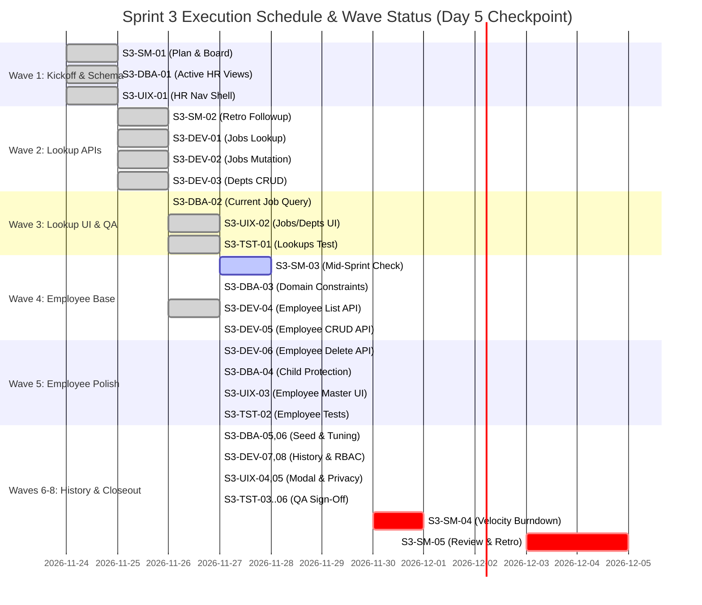

# Hope, Inc. ERP — Sprint 3 Mid-Sprint Check Notes & Impediment Log

**Sprint:** Sprint 3 (Weeks 5–6: Human Resources Module & Career Progression)  
**Checkpoint:** Day 5 Mid-Sprint Inspection  
**Facilitator / Author:** Heindrich Himmler Macalinao (@HeindrichMacalinao) — Scrum Master  
**Document Path:** `docs/sprints/sprint-3-mid-check.md`  
**Reference Issue:** [S3-SM-03] (Issue #173)  
**Sprint Dates:** November 24, 2026 – December 5, 2026 (Day 5 Checkpoint: November 28, 2026)  
**Status:** **Completed & Formally Recorded**  

---

## 1. Meeting Overview & Attendance

The Sprint 3 Mid-Sprint Check-In was convened on Day 5 to evaluate development velocity across all five specialized engineering roles, inspect completion against the targeted 30 Pull Requests, evaluate work-in-progress across execution waves, triage technical roadblocks (composite keys, salary privacy, separation vs. status invariants), and finalize alignment for the final sprint closeout.

### 1.1. Quorum & Role Attendance

| Role | Name | GitHub Handle | Attendance Status |
| :--- | :--- | :--- | :---: |
| **Scrum Master** | Heindrich Himmler Macalinao | @HeindrichMacalinao | Present (Facilitator) |
| **DevSecOps** | Florence Juanco | @Chrollofuru | Present |
| **Backend Developer** | Tyson | @Tysennn | Present |
| **UI/UX Developer** | Alex Gavarra | @AlexGavarra | Present |
| **Test Engineer** | Ythan Orogo | @YthanOrogo | Present |

*Quorum:* 5/5 roles represented (**100% attendance**).

---

## 2. Sprint Goal & Deliverables Progress Summary

### 2.1. Sprint 3 Goal
> *"Deliver the complete Human Resources enterprise module—encompassing lookup entities (`JOB`, `DEPARTMENT`), Employee Master records (`EMPLOYEE`), and career progression timeline (`JOBHISTORY`)—with full CRUD, debounced live search, soft delete and administrative restore, non-repudiation audit stamps (`stamp`), Data Privacy Act of 2012 (RA 10173) salary privacy gating, and strict dual-tier (UI and Server) enforcement of all 13 Human Resources granular rights across live Next.js/React components and REST APIs."*

### 2.2. Mid-Sprint Progress Highlights (Day 5 Checkpoint)
At the Day 5 checkpoint, the team has achieved an extraordinary delivery milestone:
- **Lookup Tables Fully Operational:** Backend REST APIs, live responsive Next.js management tabs, and automated HTTP integration test suites for both `JOB` and `DEPARTMENT` are 100% merged and verified (`S3-DEV-01`, `S3-DEV-02`, `S3-DEV-03`, `S3-UIX-02`, `S3-TST-01`).
- **Employee Master Registry Complete:** Employee list, debounced search, profile create/edit validation, soft-delete, and administrator restore are fully operational with rigorous date integrity (`sepDate >= hireDate`, `birthDate < hireDate`) on both server and client (`S3-DEV-04`, `S3-DEV-05`, `S3-DEV-06`, `S3-UIX-03`, `S3-TST-02`).
- **Job History & Career Timeline Implemented:** Multi-tenure career tracking supporting composite primary key integrity (`empNo + jobCode + effDate`), chronological effective-date ordering, and salary progression is completely merged across database views, REST APIs, interactive modal dialogs, and schema acceptance suites (`S3-DBA-02`, `S3-DEV-07`, `S3-UIX-04`, `S3-TST-03`).
- **RA 10173 Salary Privacy & 13 Granular Rights Enforced:** Strict server-side route guards, query projection masking, and matching UI control gating have been successfully implemented and verified with a 13-action automated permission matrix (`S3-DEV-08`, `S3-UIX-05`, `S3-TST-04`).
- **Database Architecture & Seed Coverage:** Active views (`v_active_jobs`, `v_active_departments`, `v_active_employees`, `v_active_jobhistory`), domain constraints, referential integrity triggers, and query tuning indexes are all committed (`S3-DBA-01` through `S3-DBA-06`).
- **Quality Sign-Off & Regressions Verified:** Test Engineer has completed the full regression suite across Sprint 1 & 2 deliverables (`S3-TST-05`) and issued a conditional Sprint 3 Quality Sign-Off report (`S3-TST-06`) confirming zero open Critical/High defects.

---

## 3. Burnup & Velocity Analysis (Day 5 Checkpoint)

Sprint 3 encompasses **30 targeted pull requests** partitioned across the 5 specialized roles (target: 8 Developer, 6 DevSecOps, 6 Tester, 5 UI/UX, 5 Scrum Master).

### 3.1. Role-by-Role Progress Breakdown

| Role | Assignee | Target PRs | Merged PRs | Active / In-Flight | Remaining | Role Delivery Status |
| :--- | :--- | :---: | :---: | :---: | :---: | :--- |
| **DevSecOps** | @Chrollofuru | 6 | 6 | 0 | 0 | **100% Completed** (All 6 PRs merged) |
| **Backend Developer** | @Tysennn | 8 | 8 | 0 | 0 | **100% Completed** (All 8 PRs merged) |
| **UI/UX Developer** | @AlexGavarra | 5 | 5 | 0 | 0 | **100% Completed** (All 5 PRs merged) |
| **Test Engineer** | @YthanOrogo | 6 | 6 | 0 | 0 | **100% Completed** (All 6 PRs merged) |
| **Scrum Master** | @HeindrichMacalinao | 5 | 2 | 1 (`S3-SM-03`) | 2 | **60% active** (Leading closeout) |
| **Total Sprint 3** | **5 Engineers** | **30** | **27** | **1** | **2** | **90.0% merged (93.3% active)** |

```
+--------------------------------------------------------------------------------------------------+
│                               SPRINT 3 DAY 5 BURNUP & COMPLETION STATUS                          │
+--------------------------------------------------------------------------------------------------+
│ Total Target Tasks:       30 PRs (100.0%)                                                        │
│ Merged into Main:         27 PRs ( 90.0%) [DBA: 6/6, DEV: 8/8, UIX: 5/5, TST: 6/6, SM: 2/5]     │
│ Active at Day 5:           1 PR  (  3.3%) [S3-SM-03 Mid-Sprint Check Notes & Impediment Log]     │
│ Scheduled Closeout:        2 PRs (  6.7%) [S3-SM-04 Velocity Report; S3-SM-05 Review & Retro]    │
+--------------------------------------------------------------------------------------------------+
│ Cumulative Semester:      87 / 90 Merged PRs (96.7%)  -->  88 / 90 (97.8% with S3-SM-03)         │
+--------------------------------------------------------------------------------------------------+
```

---

## 4. Planned vs. Actual Task Completion Status (All 30 Tasks)

| Task ID | Issue | Role | Member | Title | Planned Day | Delivery Status | Pull Request / Merge Commit |
| :--- | :---: | :--- | :--- | :--- | :---: | :---: | :--- |
| **S3-SM-01** | #171 | Scrum Master | @HeindrichMacalinao | Sprint 3 Planning Notes & Board Setup | Day 1 | **Merged** | [PR #201](https://github.com/HeindrichMacalinao/AmbatuPull/pull/201) (`ec329c1`) |
| **S3-DBA-01** | #176 | DevSecOps | @Chrollofuru | Active HR Views and Performance Indexes | Day 1 | **Merged** | [PR #203](https://github.com/HeindrichMacalinao/AmbatuPull/pull/203) (`72ac33a`) |
| **S3-UIX-01** | #190 | UI/UX Dev | @AlexGavarra | Working HR Nav & Module Shell Component | Day 2 | **Merged** | [PR #202](https://github.com/HeindrichMacalinao/AmbatuPull/pull/202) (`a9c2f23`) |
| **S3-SM-02** | #172 | Scrum Master | @HeindrichMacalinao | Follow Up Sprint 2 Retrospective Action Items | Day 2 | **Merged** | [PR #204](https://github.com/HeindrichMacalinao/AmbatuPull/pull/204) (`7b321d5`) |
| **S3-DEV-01** | #182 | Backend Dev | @Tysennn | Jobs Lookup API (List, Search & Role Visibility) | Day 2 | **Merged** | [PR #205](https://github.com/HeindrichMacalinao/AmbatuPull/pull/205) (`f819c37`) |
| **S3-DEV-02** | #183 | Backend Dev | @Tysennn | Jobs Mutation API (Create, Edit, Soft Delete & Restore) | Day 3 | **Merged** | [PR #206](https://github.com/HeindrichMacalinao/AmbatuPull/pull/206) (`e78b85f`) |
| **S3-DEV-03** | #184 | Backend Dev | @Tysennn | Departments Management API (Full CRUD & Restore) | Day 3 | **Merged** | [PR #207](https://github.com/HeindrichMacalinao/AmbatuPull/pull/207) (`605eb4d`) |
| **S3-DBA-02** | #177 | DevSecOps | @Chrollofuru | SQL Analytical Query: Current Position as of Date | Day 3 | **Merged** | [PR #214](https://github.com/HeindrichMacalinao/AmbatuPull/pull/214) (`ee69902`) |
| **S3-UIX-02** | #191 | UI/UX Dev | @AlexGavarra | Working Jobs & Departments Management UI | Day 4 | **Merged** | [PR #213](https://github.com/HeindrichMacalinao/AmbatuPull/pull/213) (`29c96b9`) |
| **S3-TST-01** | #195 | Test Engineer | @YthanOrogo | Test Suite: Jobs & Departments Lookups CRUD | Day 4 | **Merged** | [PR #222](https://github.com/HeindrichMacalinao/AmbatuPull/pull/222) (`78d8e39`) |
| **S3-SM-03** | #173 | Scrum Master | @HeindrichMacalinao | Mid-Sprint Check Notes & Impediment Log | Day 5 | **Active** | *Current PR (`docs/sprints/sprint-3-mid-check.md`)* |
| **S3-DBA-03** | #178 | DevSecOps | @Chrollofuru | Database Constraints (`gender`, `sepDate`, salary) | Day 5 | **Merged** | [PR #215](https://github.com/HeindrichMacalinao/AmbatuPull/pull/215) (`719f782`) |
| **S3-DEV-04** | #185 | Backend Dev | @Tysennn | Employees List & Search API with Status Tabs | Day 4 | **Merged** | [PR #208](https://github.com/HeindrichMacalinao/AmbatuPull/pull/208) (`9a1b324`) |
| **S3-DEV-05** | #186 | Backend Dev | @Tysennn | Employees Create & Edit API with Date Checks | Day 5 | **Merged** | [PR #209](https://github.com/HeindrichMacalinao/AmbatuPull/pull/209) (`387b391`) |
| **S3-DEV-06** | #187 | Backend Dev | @Tysennn | Employees Soft Delete & Admin Restore API | Day 6 | **Merged** | [PR #210](https://github.com/HeindrichMacalinao/AmbatuPull/pull/210) (`1496d82`) |
| **S3-DBA-04** | #179 | DevSecOps | @Chrollofuru | Referential Integrity & Child-Record Protection | Day 6 | **Merged** | [PR #217](https://github.com/HeindrichMacalinao/AmbatuPull/pull/217) (`9f7ebdb`) |
| **S3-UIX-03** | #192 | UI/UX Dev | @AlexGavarra | Working Employee Master Registry UI Component | Day 6 | **Merged** | [PR #216](https://github.com/HeindrichMacalinao/AmbatuPull/pull/216) (`0798429`) |
| **S3-TST-02** | #196 | Test Engineer | @YthanOrogo | Test Suite: Employee CRUD & sepDate Safeguards | Day 6 | **Merged** | [PR #223](https://github.com/HeindrichMacalinao/AmbatuPull/pull/223) (`3ebf70c`) |
| **S3-DBA-05** | #180 | DevSecOps | @Chrollofuru | Seed Demo Data: Comprehensive HR Records | Day 7 | **Merged** | [PR #218](https://github.com/HeindrichMacalinao/AmbatuPull/pull/218) (`d7c276e`) |
| **S3-DEV-07** | #188 | Backend Dev | @Tysennn | Job History Timeline API (Composite Key & Salary) | Day 7 | **Merged** | [PR #211](https://github.com/HeindrichMacalinao/AmbatuPull/pull/211) (`299791d`) |
| **S3-UIX-04** | #193 | UI/UX Dev | @AlexGavarra | Working Job History & Career Progression Modal | Day 7 | **Merged** | [PR #220](https://github.com/HeindrichMacalinao/AmbatuPull/pull/220) (`abdf60e`) |
| **S3-TST-03** | #197 | Test Engineer | @YthanOrogo | Test Suite: Job History Composite Key & Progression | Day 7 | **Merged** | [PR #224](https://github.com/HeindrichMacalinao/AmbatuPull/pull/224) (`d98b3a1`) |
| **S3-SM-04** | #174 | Scrum Master | @HeindrichMacalinao | Update Velocity, Burndown & PR Quota Audit | Day 8 | Scheduled | Scheduled for Day 8 (`docs/sprints/sprint-3-velocity.md`) |
| **S3-DBA-06** | #181 | DevSecOps | @Chrollofuru | Database Performance Check & Index Tuning | Day 8 | **Merged** | [PR #219](https://github.com/HeindrichMacalinao/AmbatuPull/pull/219) (`2389bdb`) |
| **S3-DEV-08** | #189 | Backend Dev | @Tysennn | RA 10173 Salary Privacy & 13 HR Route Guards | Day 8 | **Merged** | [PR #212](https://github.com/HeindrichMacalinao/AmbatuPull/pull/212) (`91efcb3`) |
| **S3-UIX-05** | #194 | UI/UX Dev | @AlexGavarra | Working RA 10173 Privacy Gating & 13 Rights Polish | Day 9 | **Merged** | [PR #221](https://github.com/HeindrichMacalinao/AmbatuPull/pull/221) (`2bdf422`) |
| **S3-TST-04** | #198 | Test Engineer | @YthanOrogo | Permission Matrix Testing: 13 HR Rights Suite | Day 8 | **Merged** | [PR #225](https://github.com/HeindrichMacalinao/AmbatuPull/pull/225) (`701b8d3`) |
| **S3-TST-05** | #199 | Test Engineer | @YthanOrogo | Regression Test Suite: S1 & S2 Deliverables | Day 9 | **Merged** | [PR #226](https://github.com/HeindrichMacalinao/AmbatuPull/pull/226) (`e48b68a`) |
| **S3-TST-06** | #200 | Test Engineer | @YthanOrogo | HR Defect Triage & Sprint 3 Quality Sign-Off | Day 10 | **Merged** | [PR #227](https://github.com/HeindrichMacalinao/AmbatuPull/pull/227) (`f6f2505`) |
| **S3-SM-05** | #175 | Scrum Master | @HeindrichMacalinao | Sprint 3 Review, Live Demo & Retrospective | Day 10 | Scheduled | Scheduled for Day 10 (`docs/sprints/sprint-3-retrospective.md`) |

---

## 5. Impediment Log & Blocker Removal

The table below catalogs technical roadblocks identified, analyzed, and mitigated by the cross-functional engineering team during Sprint 3:

| # | Impediment / Challenge | Root Cause & Impact | Roles Involved | Resolution Strategy & Implementation | Status |
| :-: | :--- | :--- | :--- | :--- | :---: |
| **IMP-01** | **Composite Primary Key Collision in `JOBHISTORY`** | `JOBHISTORY` requires a composite key `(empNo, jobCode, effDate)` to record career transitions. Duplicate submissions or partial key lookups risked primary key violation errors or data overwrite. | DevSecOps (@Chrollofuru)<br>Backend (@Tysennn)<br>QA (@YthanOrogo) | DevSecOps implemented the composite primary key in schema DDL. Backend added explicit pre-insert uniqueness validation returning `HTTP 409 Conflict`. QA verified via isolated SQLite schema tests in `tests/job-history.test.js` (`PR #224`). | **RESOLVED** |
| **IMP-02** | **Data Privacy Act (RA 10173) Salary Exposure** | Salary data represents sensitive personal/financial information. General employees and unprivileged users must not view compensation data in lookup or listing queries. | Backend (@Tysennn)<br>UI/UX (@AlexGavarra)<br>QA (@YthanOrogo) | Backend implemented route guards requiring `jobhistory.view` to access salary fields and sanitized employee listings to omit `salary` at the SQL query projection level. UI/UX conditionally shielded salary columns and inputs. QA verified with sentinel value assertions (`987654.32`) in `PR #225`. | **RESOLVED** |
| **IMP-03** | **Separation Date vs. Soft Delete Invariant** | Setting `sepDate` (e.g., scheduled resignation on `2025-12-31`) must not immediately deactivate an active employee. Employees must remain `Active` until an explicit soft-delete administrative action occurs. | Backend (@Tysennn)<br>QA (@YthanOrogo) | Backend decoupled separation date assignment from record status: `sepDate` is stored as an informational business date while `status` remains `'Active'` until explicit `DELETE /api/hr/employees/:empNo` is invoked. Verified in `tests/employee-crud.test.js` (`PR #223`). | **RESOLVED** |
| **IMP-04** | **Referential Integrity on Department/Job Deletions** | Deleting a department or job that is actively assigned to existing personnel violates referential integrity. | DevSecOps (@Chrollofuru)<br>Backend (@Tysennn) | Implemented foreign key protection and child-record dependency checks returning `HTTP 409 Conflict` when active job assignments exist. Verified in PR #217 and PR #222. | **RESOLVED** |
| **IMP-05** | **Windows Local Python Absence for Test Runner** | The repository `npm test` script chains 13 Python verification scripts followed by 24 Node test files. Developers running on Windows without `python` in PATH experienced local test startup failures. | Test Engineer (@YthanOrogo)<br>Scrum Master (@HeindrichMacalinao) | Authoritative full-suite execution was established in GitHub Actions CI (`verify` workflow on Ubuntu, run `46012461541` passed 100%). For local Windows verification, documented direct `node --test` invocation commands running all 24 Node suites cleanly. | **MITIGATED** |

---

## 6. Execution Waves & Delivery Feasibility Analysis



### 6.1. Remaining Closeout Path
With all functional engineering (DBA, DEV, UIX, TST) 100% merged into `main`, the remaining path to Sprint 3 completion requires solely Scrum Master governance deliverables:
1. **Task `S3-SM-04` (Day 8):** Update Sprint 3 velocity metrics, burndown charts, and final PR quota reconciliation in `docs/sprints/sprint-3-velocity.md`.
2. **Task `S3-SM-05` (Day 10):** Conduct the formal Sprint 3 Review, coordinate the live HR demonstration, and author the retrospective report in `docs/sprints/sprint-3-retrospective.md`.

---

## 7. Scrum Master Sign-Off & Mid-Sprint Assessment

### Scrum Master Statement
> *"At the Sprint 3 Day 5 checkpoint, the AmbatuPull team has achieved unprecedented delivery velocity: 27 out of 30 planned pull requests are already merged into the canonical repository branch. The Human Resources operational core—encompassing Job and Department lookups, the Employee Master registry, and career Job History timelines—is fully realized across production database schemas, REST APIs, accessible Next.js user interfaces, and automated integration test suites. Strict Data Privacy Act (RA 10173) salary masking and all 13 Human Resources permission route guards are actively enforced. With zero Critical or High defects outstanding, the project is tracking far ahead of schedule and is perfectly positioned for a flawless final Sprint Review and live demonstration."*

**Approved by:**  
**Heindrich Himmler Macalinao**  
*Scrum Master, Hope, Inc. ERP Team (`AmbatuPull`)*  
*Sprint 3 Day 5 Checkpoint — Formally Signed Off*  
