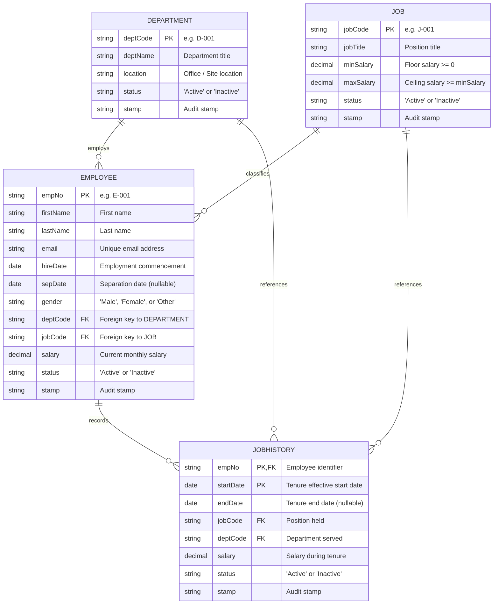

# Hope, Inc. ERP — Sprint 3 Planning Notes & Board Setup

**Sprint:** Sprint 3 (Weeks 5–6: Human Resources Module & Career Progression)  
**Document Path:** `docs/sprints/sprint-3-planning.md`  
**Reference Issue:** [S3-SM-01] (Issue #171)  
**Facilitator / Author:** Heindrich Himmler Macalinao (@HeindrichMacalinao) — Scrum Master  
**Sprint Dates:** November 24, 2026 – December 5, 2026  
**Status:** **Approved & Active**  

---

## 1. Executive Summary & Sprint Goal Definition

### 1.1. Sprint 3 Goal
> *"Deliver the complete Human Resources enterprise module—encompassing lookup entities (`JOB`, `DEPARTMENT`), Employee Master records (`EMPLOYEE`), and career progression timeline (`JOBHISTORY`)—with full CRUD, debounced live search, soft delete and administrative restore, non-repudiation audit stamps (`stamp`), Data Privacy Act of 2012 (RA 10173) salary privacy gating, and strict dual-tier (UI and Server) enforcement of all 13 Human Resources granular rights across live Next.js/React components and REST APIs."*

### 1.2. Strategic Objectives & Standards
1. **Human Resources Operational Core (§1.1, §3.3, §4.1 Step 6):**
   - Implement normalized relational models for `JOB`, `DEPARTMENT`, `EMPLOYEE`, and `JOBHISTORY`.
   - Maintain referential integrity: Prevent deletion of departments or jobs that have active assigned employees.
   - Support composite primary key integrity on `JOBHISTORY` (`(empNo, startDate)` or `(empNo, effDate)`).
2. **Data Privacy Act of 2012 (RA 10173) Compliance:**
   - Salary data is classified as sensitive financial/personal information.
   - Enforce server-side salary masking and UI visibility gating: Standard users without administrative HR rights receive sanitized employee profiles with salary fields redacted.
3. **13 Granular Human Resources Rights Enforcement:**
   - Both server routes and UI actions must strictly respect the 13 HR rights catalog.
   - Direct API calls attempting unauthorized mutations must unconditionally return `HTTP 403 Forbidden`.
4. **Mandatory UI/UX Working Code Standard:**
   - In accordance with Sprint 2 retrospective resolutions, all UI/UX deliverables must be **runnable Next.js/React UI files** (`src/components/`, `src/app/`) integrated directly with live backend endpoints—no static mockups.

---

## 2. Capacity Allocation & PR Quota Alignment

The team capacity is budgeted across all five specialized engineering roles to fulfill the project grading thresholds and deliver 30 high-quality pull requests (reaching 90 cumulative merged PRs for the semester):

```
+--------------------------------------------------------------------------------------------------+
│                             SPRINT 3 CAPACITY & PR QUOTA BREAKDOWN                              │
+-----------------------+-------------------------+--------------------+------------+--------------+
│ Role                  │ Team Member             │ GitHub Handle      │ Target PRs │ Quota Share  │
+-----------------------+-------------------------+--------------------+------------+--------------+
│ **Scrum Master**      │ Heindrich H. Macalinao  │ @HeindrichMacalinao│ 5 PRs      │ 16.7%        │
│ **DevSecOps**         │ Florence Juanco         │ @Chrollofuru       │ 6 PRs      │ 20.0%        │
│ **Backend Developer** │ Tyson                   │ @Tysennn           │ 8 PRs      │ 26.7%        │
│ **UI/UX Developer**   │ Alex Gavarra            │ @AlexGavarra       │ 5 PRs      │ 16.7%        │
│ **Test Engineer**     │ Ythan Orogo             │ @YthanOrogo        │ 6 PRs      │ 20.0%        │
+-----------------------+-------------------------+--------------------+------------+--------------+
│ **Total Capacity**    │ 5 Dedicated Engineers   │ —                  │ **30 PRs** │ **100.0%**   │
+-----------------------+-------------------------+--------------------+------------+--------------+
```

### Role Work Breakdown
- **Scrum Master (5 PRs):** Kickoff planning & board setup (`S3-SM-01`), Sprint 2 retro follow-up (`S3-SM-02`), Day 5 mid-sprint check & blocker resolution (`S3-SM-03`), velocity & PR burndown tracking (`S3-SM-04`), Sprint 3 review, demo & retrospective (`S3-SM-05`).
- **DevSecOps (6 PRs):** Active HR database views & indexes (`S3-DBA-01`), analytical SQL query for current employee position (`S3-DBA-02`), database domain & date constraints (`S3-DBA-03`), child-record foreign key protection (`S3-DBA-04`), comprehensive HR demo seed dataset (`S3-DBA-05`), query profiling & index tuning (`S3-DBA-06`).
- **Backend Developer (8 PRs):** Jobs lookup API (`S3-DEV-01`), Jobs mutation API (`S3-DEV-02`), Departments CRUD API (`S3-DEV-03`), Employees list & search API (`S3-DEV-04`), Employees create/edit API (`S3-DEV-05`), Employees soft-delete & restore API (`S3-DEV-06`), Job History timeline API (`S3-DEV-07`), RA 10173 salary privacy gating & 13 HR route guards (`S3-DEV-08`).
- **UI/UX Developer (5 PRs):** Working HR shell navigation component (`S3-UIX-01`), working Jobs & Departments management UI (`S3-UIX-02`), working Employee Master registry UI (`S3-UIX-03`), working Job History modal dialog (`S3-UIX-04`), working RA 10173 privacy gating & 13-rights button hiding UI (`S3-UIX-05`).
- **Test Engineer (6 PRs):** Jobs & Departments test suite (`S3-TST-01`), Employee Master test suite (`S3-TST-02`), Job History composite key test suite (`S3-TST-03`), 13 HR rights permission matrix test suite (`S3-TST-04`), S1/S2 regression test suite (`S3-TST-05`), HR defect triage & quality sign-off (`S3-TST-06`).

---

## 3. Project Board Governance & Workflows

### 3.1. Kanban Columns & Work-in-Progress (WIP) Limits
To prevent task pile-ups and ensure steady flow through code reviews, GitHub Project Board iterations are configured with strict WIP constraints:

```
+--------------------------------------------------------------------------------------------------+
│                             GITHUB PROJECT BOARD WORKFLOW & WIP LIMITS                           │
+-------------------+-------------------+-------------------+-------------------+------------------+
│ Column 1: Backlog │ Column 2: Ready   │ Column 3: In Prog │ Column 4: In Rev  │ Column 5: Done   │
│ (WIP Limit: 3)    │ (Sprint Backlog)  │ (WIP Limit: 3)    │ (WIP Limit: 5)    │ (No Limit)       │
+-------------------+-------------------+-------------------+-------------------+------------------+
│ Up to 3 prioritized│ 30 Sprint 3 Tasks │ Max 3 active      │ Max 5 active PRs  │ Merged PRs       │
│ upcoming tasks    │ ready to be pulled│ branches across   │ in peer review    │ verified in      │
│ for next wave     │ by role owners    │ entire team       │ SLA: < 24 hours   │ `main` branch    │
+-------------------+-------------------+-------------------+-------------------+------------------+
```

### 3.2. Strict File Ownership Rules (Conflict Prevention)
To maintain our track record of **0 merge conflicts**, each role strictly adheres to isolated file boundaries:

| Role | Primary Assignee | Strict File Ownership (Nobody Else Modifies These) |
| :--- | :--- | :--- |
| **Scrum Master** | `@HeindrichMacalinao` | `docs/sprints/` (Sprint planning, mid-checks, burndown, retro) |
| **DevSecOps** | `@Chrollofuru` | `migrations/`, `db/`, `docs/database/` |
| **Backend Developer** | `@Tysennn` | `src/routes/`, `src/controllers/`, `src/middleware/`, `src/models/` |
| **UI/UX Developer** | `@AlexGavarra` | `src/components/`, `src/app/`, `docs/ui/` *(Working Next.js UI files)* |
| **Test Engineer** | `@YthanOrogo` | `tests/`, `docs/testing/` |

### 3.3. Quality Gates & Definition of Done (DoD)
Every pull request must satisfy the following checklist before merge approval:
- [x] Branch originated directly from the latest `main` (`git pull origin main`).
- [x] Functional code and documentation comply with project conventions.
- [x] Deterministic automated test suite passes (`npm test` passes without external dependencies).
- [x] Zero plain-text credentials or API secrets.
- [x] Binary `.db` SQLite files are unstaged/reverted (`git checkout -- *.db`).
- [x] Code peer-reviewed and approved by at least one other team member.

---

## 4. Human Resources Module Technical Specifications

### 4.1. Entity Schema & Domain Rules


### 4.2. RA 10173 Salary Privacy Gating
Under Philippine Republic Act No. 10173 (Data Privacy Act of 2012), individual employee salaries represent sensitive personal data:
- **Server Enforcement:** `GET /api/hr/employees` and `GET /api/hr/employees/:empNo` sanitize responses. If the requesting session lacks authorized administrative rights (`admin`, `superadmin`, or explicit HR rights), the `salary` column is redacted (`"salary": "[REDACTED]"` or `null`).
- **UI Enforcement:** In `src/components/HumanResourcesManagement.tsx` and `src/components/JobHistoryModal.tsx`, salary columns and edit inputs are rendered only for authorized sessions. Unauthorized views display a masked badge: `🔒 Confidential (RA 10173)`.

### 4.3. 13 Granular Human Resources Rights Catalog
```
+----+----------------------+------------------------------------------------------------------------+
│ #  │ Permission Key       │ Functional Capability & Route Guarded                                 │
+----+----------------------+------------------------------------------------------------------------+
│ 1  │ `hr.view`            │ View HR module in sidebar and access HR workbench                     │
│ 2  │ `hr.job_view`        │ View Job listings (`GET /api/hr/jobs`)                                │
│ 3  │ `hr.job_add`         │ Create new Job positions (`POST /api/hr/jobs`)                        │
│ 4  │ `hr.job_edit`        │ Modify Job details & salary bands (`PUT /api/hr/jobs/:code`)          │
│ 5  │ `hr.job_delete`      │ Soft delete / restore Jobs (`DELETE /api/hr/jobs/:code`)              │
│ 6  │ `hr.dept_view`       │ View Department listings (`GET /api/hr/departments`)                  │
│ 7  │ `hr.dept_add`        │ Create new Departments (`POST /api/hr/departments`)                   │
│ 8  │ `hr.dept_edit`       │ Modify Department information (`PUT /api/hr/departments/:code`)       │
│ 9  │ `hr.dept_delete`     │ Soft delete / restore Departments (`DELETE /api/hr/departments/:code`)│
│ 10 │ `hr.employee_view`   │ View Employee registry (`GET /api/hr/employees`)                      │
│ 11 │ `hr.employee_add`    │ Register new employees (`POST /api/hr/employees`)                     │
│ 12 │ `hr.employee_edit`   │ Edit employee profile details (`PUT /api/hr/employees/:empNo`)         │
│ 13 │ `hr.employee_delete` │ Soft delete / restore employees (`DELETE /api/hr/employees/:empNo`)   │
+----+----------------------+------------------------------------------------------------------------+
```

---

## 5. Wave-by-Wave Execution Architecture

```mermaid
flowchart TD
    classDef sm fill:#c2e0c6,stroke:#2e7d32,color:#000
    classDef dba fill:#d1c4e9,stroke:#512da8,color:#000
    classDef dev fill:#bbdefb,stroke:#1565c0,color:#000
    classDef uix fill:#f8bbd0,stroke:#c2185b,color:#000
    classDef tst fill:#b2dfdb,stroke:#00695c,color:#000

    subgraph W1["Wave 1: Sprint 3 Kickoff & Lookup Architecture (Days 1–2)"]
        SM1["#171: S3-SM-01<br>(Board & Plan Setup)"]:::sm
        DBA1["#176: S3-DBA-01<br>(Active HR Views & Indexes)"]:::dba
        UIX1["#190: S3-UIX-01<br>(Working HR Nav Shell)"]:::uix
    end

    subgraph W2["Wave 2: Lookup Tables CRUD & Retro Follow-up (Days 2–3)"]
        SM2["#172: S3-SM-02<br>(Retro Follow-up)"]:::sm
        DEV1["#182: S3-DEV-01<br>(Jobs List & Search API)"]:::dev
        DEV2["#183: S3-DEV-02<br>(Jobs Mutation API)"]:::dev
        DEV3["#184: S3-DEV-03<br>(Departments CRUD API)"]:::dev
    end

    subgraph W3["Wave 3: Lookup QA, Current Job Query & Working UI (Days 3–4)"]
        DBA2["#177: S3-DBA-02<br>(Current Job SQL Query)"]:::dba
        UIX2["#191: S3-UIX-02<br>(Working Jobs/Depts UI)"]:::uix
        TST1["#195: S3-TST-01<br>(Jobs/Depts Test Suite)"]:::tst
    end

    subgraph W4["Wave 4: Mid-Sprint Check & Employee Master Base (Days 5–6)"]
        SM3["#173: S3-SM-03<br>(Mid-Sprint Check Day 5)"]:::sm
        DBA3["#178: S3-DBA-03<br>(HR Domain Constraints)"]:::dba
        DEV4["#185: S3-DEV-04<br>(Employee List & Search API)"]:::dev
        DEV5["#186: S3-DEV-05<br>(Employee Create/Edit API)"]:::dev
    end

    subgraph W5["Wave 5: Employee Soft Delete & Working UI (Days 6–7)"]
        DEV6["#187: S3-DEV-06<br>(Employee Delete/Restore API)"]:::dev
        DBA4["#179: S3-DBA-04<br>(Child Delete Protection)"]:::dba
        UIX3["#192: S3-UIX-03<br>(Working Employee Master UI)"]:::uix
        TST2["#196: S3-TST-02<br>(Employee CRUD Test Suite)"]:::tst
    end

    subgraph W6["Wave 6: Job History Timeline & Working Modal Dialog (Days 7–8)"]
        DBA5["#180: S3-DBA-05<br>(Seed HR Demo Data)"]:::dba
        DEV7["#188: S3-DEV-07<br>(Job History Timeline API)"]:::dev
        UIX4["#193: S3-UIX-04<br>(Working Job History Modal UI)"]:::uix
        TST3["#197: S3-TST-03<br>(Job History Test Suite)"]:::tst
    end

    subgraph W7["Wave 7: RA 10173 Salary Privacy & 13 HR Rights (Days 8–9)"]
        SM4["#174: S3-SM-04<br>(Velocity & Burndown)"]:::sm
        DBA6["#181: S3-DBA-06<br>(HR Performance Tuning)"]:::dba
        DEV8["#189: S3-DEV-08<br>(13 Rights & Salary Gating)"]:::dev
        UIX5["#194: S3-UIX-05<br>(Working Privacy UI & Polish)"]:::uix
        TST4["#198: S3-TST-04<br>(13-Rights Matrix Testing)"]:::tst
    end

    subgraph W8["Wave 8: Regression, Sign-Off & Demo (Days 9–10)"]
        TST5["#199: S3-TST-05<br>(S1 & S2 Regression Suite)"]:::tst
        TST6["#200: S3-TST-06<br>(Sprint 3 QA Sign-Off)"]:::tst
        SM5["#175: S3-SM-05<br>(Sprint 3 Review & Retro)"]:::sm
    end

    %% Key Dependencies
    SM1 --> DEV1
    DBA1 --> DEV1
    UIX1 --> UIX2
    DEV1 --> DEV2
    DEV2 --> TST1
    DEV3 --> TST1
    DEV2 --> UIX2
    DEV3 --> UIX2
    DBA1 --> DEV4
    DBA3 --> DEV5
    DEV4 --> DEV5
    DEV5 --> DEV6
    DEV5 --> UIX3
    DEV6 --> UIX3
    DEV5 --> TST2
    DEV6 --> TST2
    DBA2 --> DEV7
    DBA5 --> DEV7
    DEV7 --> UIX4
    DEV7 --> TST3
    DEV8 --> UIX5
    DEV8 --> TST4
    UIX5 --> TST6
    TST4 --> TST6
    TST5 --> TST6
    TST6 --> SM5
```



---

## 6. Sprint 3 Task Registry & PR Tracking

| Task ID | Issue | Role | Assignee | Delivery Focus & Key Files | Due Day | Status |
| :--- | :---: | :--- | :--- | :--- | :---: | :---: |
| `S3-SM-01` | [#171](https://github.com/HeindrichMacalinao/AmbatuPull/issues/171) | Scrum Master | @HeindrichMacalinao | `docs/sprints/sprint-3-planning.md` & Project Board Setup | Day 1 | **Open** |
| `S3-DBA-01` | [#176](https://github.com/HeindrichMacalinao/AmbatuPull/issues/176) | DevSecOps | @Chrollofuru | `migrations/` & `db/` (`v_active_employees`, `v_active_jobs`, etc.) | Day 1 | **Open** |
| `S3-UIX-01` | [#190](https://github.com/HeindrichMacalinao/AmbatuPull/issues/190) | UI/UX Dev | @AlexGavarra | `src/components/HumanResourcesManagement.tsx` (Working HR tab shell) | Day 2 | **Open** |
| `S3-SM-02` | [#172](https://github.com/HeindrichMacalinao/AmbatuPull/issues/172) | Scrum Master | @HeindrichMacalinao | `docs/sprints/sprint-3-retro-followup.md` (Audit retro action items) | Day 2 | **Open** |
| `S3-DEV-01` | [#182](https://github.com/HeindrichMacalinao/AmbatuPull/issues/182) | Backend Dev | @Tysennn | `src/routes/jobs.js` (`GET /api/hr/jobs` with search & role visibility) | Day 2 | **Open** |
| `S3-DEV-02` | [#183](https://github.com/HeindrichMacalinao/AmbatuPull/issues/183) | Backend Dev | @Tysennn | `src/routes/jobs.js` (POST, PUT, DELETE, restore with audit stamps) | Day 3 | **Open** |
| `S3-DEV-03` | [#184](https://github.com/HeindrichMacalinao/AmbatuPull/issues/184) | Backend Dev | @Tysennn | `src/routes/departments.js` (Full Department CRUD, search & stamps) | Day 3 | **Open** |
| `S3-DBA-02` | [#177](https://github.com/HeindrichMacalinao/AmbatuPull/issues/177) | DevSecOps | @Chrollofuru | `db/verify/verify_current_job.sql` (Analytical current position query) | Day 3 | **Open** |
| `S3-UIX-02` | [#191](https://github.com/HeindrichMacalinao/AmbatuPull/issues/191) | UI/UX Dev | @AlexGavarra | `src/components/HumanResourcesManagement.tsx` (Working Jobs/Depts UI) | Day 4 | **Open** |
| `S3-TST-01` | [#195](https://github.com/HeindrichMacalinao/AmbatuPull/issues/195) | Test Engineer | @YthanOrogo | `tests/hr-lookups.test.js` (Jobs & Departments test suite) | Day 4 | **Open** |
| `S3-SM-03` | [#173](https://github.com/HeindrichMacalinao/AmbatuPull/issues/173) | Scrum Master | @HeindrichMacalinao | `docs/sprints/sprint-3-mid-check.md` (Day 5 velocity check & blocker log) | Day 5 | **Open** |
| `S3-DBA-03` | [#178](https://github.com/HeindrichMacalinao/AmbatuPull/issues/178) | DevSecOps | @Chrollofuru | `migrations/` (`gender` check, `sepDate >= hireDate`, salary domain) | Day 5 | **Open** |
| `S3-DEV-04` | [#185](https://github.com/HeindrichMacalinao/AmbatuPull/issues/185) | Backend Dev | @Tysennn | `src/routes/employees.js` (`GET /api/hr/employees` with status tabs) | Day 4 | **Open** |
| `S3-DEV-05` | [#186](https://github.com/HeindrichMacalinao/AmbatuPull/issues/186) | Backend Dev | @Tysennn | `src/routes/employees.js` (POST & PUT with date checks & audit stamps) | Day 5 | **Open** |
| `S3-DEV-06` | [#187](https://github.com/HeindrichMacalinao/AmbatuPull/issues/187) | Backend Dev | @Tysennn | `src/routes/employees.js` (Soft delete & restore with separation logic) | Day 6 | **Open** |
| `S3-DBA-04` | [#179](https://github.com/HeindrichMacalinao/AmbatuPull/issues/179) | DevSecOps | @Chrollofuru | `db/verify/verify_hr_referential_integrity.sql` (Child delete protection) | Day 6 | **Open** |
| `S3-UIX-03` | [#192](https://github.com/HeindrichMacalinao/AmbatuPull/issues/192) | UI/UX Dev | @AlexGavarra | `src/components/HumanResourcesManagement.tsx` (Working Employee UI) | Day 6 | **Open** |
| `S3-TST-02` | [#196](https://github.com/HeindrichMacalinao/AmbatuPull/issues/196) | Test Engineer | @YthanOrogo | `tests/employee-crud.test.js` (Employee CRUD test suite) | Day 6 | **Open** |
| `S3-DBA-05` | [#180](https://github.com/HeindrichMacalinao/AmbatuPull/issues/180) | DevSecOps | @Chrollofuru | `db/seeds/004_human_resources_seed.sql` (Seed HR demo dataset) | Day 7 | **Open** |
| `S3-DEV-07` | [#188](https://github.com/HeindrichMacalinao/AmbatuPull/issues/188) | Backend Dev | @Tysennn | `src/routes/jobHistory.js` (Job History promotion/transfer CRUD) | Day 7 | **Open** |
| `S3-UIX-04` | [#193](https://github.com/HeindrichMacalinao/AmbatuPull/issues/193) | UI/UX Dev | @AlexGavarra | `src/components/JobHistoryModal.tsx` (Working Job History modal) | Day 7 | **Open** |
| `S3-TST-03` | [#197](https://github.com/HeindrichMacalinao/AmbatuPull/issues/197) | Test Engineer | @YthanOrogo | `tests/job-history.test.js` (Job History composite key test suite) | Day 7 | **Open** |
| `S3-SM-04` | [#174](https://github.com/HeindrichMacalinao/AmbatuPull/issues/174) | Scrum Master | @HeindrichMacalinao | `docs/sprints/sprint-3-velocity.md` (Velocity, burndown & PR quota check) | Day 8 | **Open** |
| `S3-DBA-06` | [#181](https://github.com/HeindrichMacalinao/AmbatuPull/issues/181) | DevSecOps | @Chrollofuru | `docs/database/sprint-3-performance.md` (Query profiling & index tuning) | Day 8 | **Open** |
| `S3-DEV-08` | [#189](https://github.com/HeindrichMacalinao/AmbatuPull/issues/189) | Backend Dev | @Tysennn | `src/middleware/rbac.js` (13 HR route guards & salary privacy gating) | Day 8 | **Open** |
| `S3-UIX-05` | [#194](https://github.com/HeindrichMacalinao/AmbatuPull/issues/194) | UI/UX Dev | @AlexGavarra | `src/components/HumanResourcesManagement.tsx` (Working privacy & polish) | Day 9 | **Open** |
| `S3-TST-04` | [#198](https://github.com/HeindrichMacalinao/AmbatuPull/issues/198) | Test Engineer | @YthanOrogo | `docs/testing/hr-permission-matrix.md` (13 HR rights testing) | Day 8 | **Open** |
| `S3-TST-05` | [#199](https://github.com/HeindrichMacalinao/AmbatuPull/issues/199) | Test Engineer | @YthanOrogo | `docs/testing/sprint-3-regression.md` (S1 & S2 regression test suite) | Day 9 | **Open** |
| `S3-TST-06` | [#200](https://github.com/HeindrichMacalinao/AmbatuPull/issues/200) | Test Engineer | @YthanOrogo | `docs/testing/sprint-3-signoff.md` (Sprint 3 QA Quality Sign-Off report) | Day 10 | **Open** |
| `S3-SM-05` | [#175](https://github.com/HeindrichMacalinao/AmbatuPull/issues/175) | Scrum Master | @HeindrichMacalinao | `docs/sprints/sprint-3-retrospective.md` (Live demo & retro report) | Day 10 | **Open** |

---

## 7. Sign-Off & Sprint Kickoff Approval

| Role | Name | GitHub Handle | Decision | Date |
| :--- | :--- | :--- | :---: | :---: |
| **Scrum Master** | Heindrich Himmler Macalinao | @HeindrichMacalinao | **APPROVED & ACTIVE** | 2026-11-24 |
