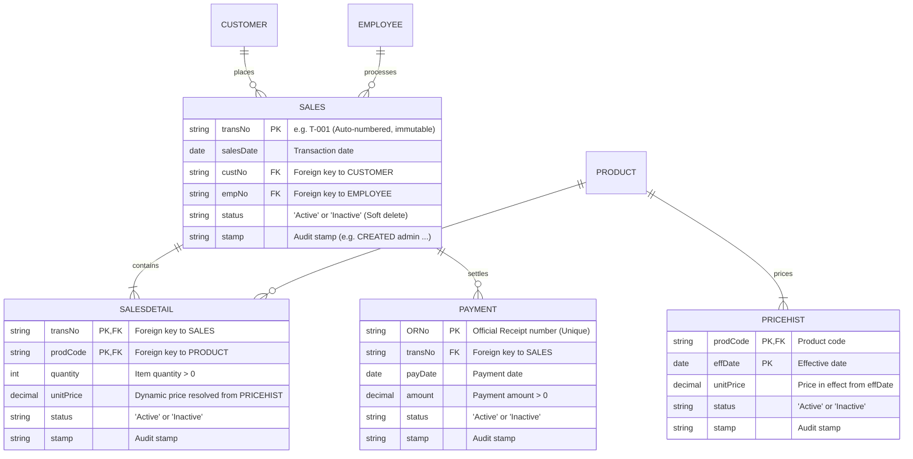
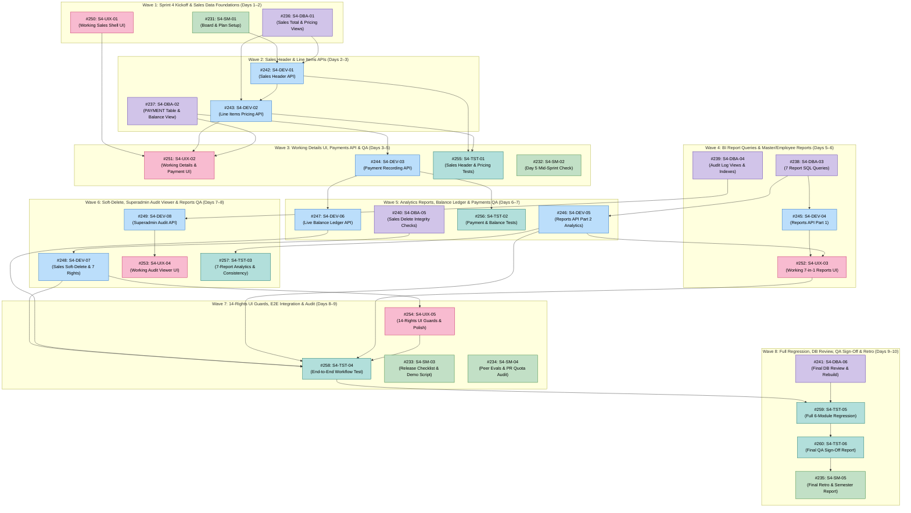

# Hope, Inc. ERP — Sprint 4 Planning Notes, Capacity Allocation & Final Project Board Setup

**Sprint:** Sprint 4 (Weeks 7–8: Sales Orders, Payments, BI Reports, Superadmin Audit & Final Production QA)  
**Document Path:** `docs/sprints/sprint-4-planning.md`  
**Reference Issue:** [S4-SM-01] (Issue #231)  
**Facilitator / Author:** Heindrich Himmler Macalinao (@HeindrichMacalinao) — Scrum Master  
**Sprint Dates:** December 8, 2026 – December 19, 2026  
**Target Milestone:** **120 Cumulative Merged PRs** (Sprint 1: 30 + Sprint 2: 30 + Sprint 3: 30 + Sprint 4: 30)  
**Status:** **Approved & Active**  

---

## 1. Executive Summary & Sprint Goal Definition

### 1.1. Sprint 4 Goal
> *"Deliver the complete Sales & Orders module (auto-numbered transaction headers `SALES`, line items `SALESDETAIL` with dynamic historical price lookup as of `salesDate`, payments ledger `PAYMENT`, and real-time derived balance calculations `balance = total - sum(payments)`), all 7 Executive Business Intelligence (BI) Reports (with date filtering, Top N limits, Print & Save as PDF, and mathematical consistency verification), the Superadmin Audit Log Viewer, and dual-tier (UI and Server) enforcement of all 14 remaining granular rights (7 Sales + 7 Reports). Conclude with full end-to-end integration testing, full 6-module regression across all semester deliverables, clean database migration rebuild verification, and final Hope, Inc. ERP Production Quality Sign-Off."*

### 1.2. Strategic Objectives & Standards
1. **Sales & Orders Operational Core (§1.1, §2.2, §2.5, §3.6, §4.1 Step 7, §4.2):**
   - **Auto-Numbered Transaction Identifier:** Enforce immutable, auto-incrementing transaction numbering (e.g., `T-001`, `T-002`) that cannot be manually edited or forged.
   - **Foreign Key Dropdowns:** New Sale header modal enforces selection of active customers (`CUSTOMER`) and active employees/salespersons (`EMPLOYEE`).
   - **Master-Detail Line Items:** Line items (`SALESDETAIL`) record `prodCode`, `quantity`, resolved `unitPrice`, and calculated `lineTotal = quantity * unitPrice`.
2. **Dynamic Historical Pricing Integrity (§2.5):**
   - Unit price must strictly be resolved from `PRICEHIST` as of the sale's `salesDate` (`effDate <= salesDate ORDER BY effDate DESC LIMIT 1`).
   - Catalog price adjustments occurring after `salesDate` must never retroactively alter historical transaction line item prices.
3. **Strict Derived Data Rule (Student Guide §2.2 & §2.5):**
   - Redundant derived values are never stored as static columns:
     - `SALES` has no `total` column; transaction totals are dynamically calculated from active `SALESDETAIL` lines via `v_sales_summary`.
     - `PRODUCT` has no `currentPrice` column; current prices are resolved on the fly from `PRICEHIST`.
     - `balance` is calculated on demand via `v_sales_balance`: `balance = transactionTotal - coalesce(sum(payments), 0)`.
4. **Payments Ledger & Transaction Balance Ledger (§2.2, §4.2):**
   - Implement `PAYMENT` ledger table with unique Official Receipt number (`ORNo`), positive amount constraint (`amount > 0`), and audit stamp.
   - Server-side guard prevents overpayments exceeding the outstanding transaction balance.
5. **7 Executive Business Intelligence Reports (§3.7):**
   - Deliver optimized queries and views for: Top Customers, Product Master List, Top Products, Active Employees, All Employees, Employee Job History, and Top Sales.
   - Enforce the **Mathematical Consistency Rule (Student Guide §3.7 Try It)**: For any matching date range, `SUM(Top Products sales amount)` must equal `SUM(Top Customers total)` and the aggregate of active sales.
   - Every report supports responsive on-screen display, browser Print (`window.print()`), and Save as PDF.
6. **Superadmin Audit Log Viewer (§1.2, §3.8):**
   - Dedicated viewer component mounted under System tab, accessible strictly to the `Superadmin` role.
   - Live stream with multi-attribute filtering (user ID/email, action type, table/entity, timestamp range) and JSON diff inspector.
7. **14 Granular Rights Enforcement (7 Sales + 7 Reports):**
   - Strict dual-tier enforcement across backend Express API routes (returning `HTTP 403 Forbidden` for unauthorized calls) and frontend React components (conditionally hiding action buttons, sub-tabs, and detail modals).
8. **Mandatory UI/UX Working Code Standard:**
   - In accordance with team standards established in Sprint 2 and refined in Sprint 3, all UI/UX deliverables must be **runnable Next.js/React UI files** (`src/components/`, `src/app/`) integrated directly with live backend endpoints and the database—no static mockups or wireframes.

---

## 2. Capacity Allocation & PR Quota Alignment

Team capacity is budgeted across all five specialized engineering roles to fulfill the academic grading thresholds, delivering 30 high-quality pull requests and bringing the project to **120 cumulative merged pull requests** across the 8-week semester:

```
+--------------------------------------------------------------------------------------------------+
│                             SPRINT 4 CAPACITY & PR QUOTA BREAKDOWN                               │
+-----------------------+-------------------------+--------------------+------------+--------------+
│ Role                  │ Team Member             │ GitHub Handle      │ Target PRs │ Quota Share  │
+-----------------------+-------------------------+--------------------+------------+--------------+
│ **Scrum Master**      │ Heindrich H. Macalinao  │ @HeindrichMacalinao│ 5 PRs      │ 16.7%        │
│ **DevSecOps**         │ Florence Juanco         │ @Chrollofuru       │ 6 PRs      │ 20.0%        │
│ **Backend Developer** │ Tyson                   │ @Tysennn           │ 8 PRs      │ 26.7%        │
│ **UI/UX Developer**   │ Alex Gavarra            │ @AlexGavarra       │ 5 PRs      │ 16.7%        │
│ **Test Engineer**     │ Ythan Orogo             │ @YthanOrogo        │ 6 PRs      │ 20.0%        │
+-----------------------+-------------------------+--------------------+------------+--------------+
│ **Total Capacity**    │ 5 Dedicated Engineers   │ —                  │ **30 PRs** │ **100.0%**   │
+-----------------------+-------------------------+--------------------+------------+--------------+
```

### Cumulative Semester Milestone Progression
- **Sprint 1 (Weeks 1–2):** 30 Merged PRs — Auth, User Management & RBAC Foundation (30/30)
- **Sprint 2 (Weeks 3–4):** 30 Merged PRs — Customer & Live Product Catalog Management (60/60)
- **Sprint 3 (Weeks 5–6):** 30 Merged PRs — Human Resources & Career Progression (90/90)
- **Sprint 4 (Weeks 7–8):** 30 Merged PRs — Sales, Payments, BI Reports, Audit & QA Sign-Off (**120/120 Target**)

### Role Work Breakdown
- **Scrum Master (5 PRs):**
  - `S4-SM-01` (#231): Sprint 4 Kickoff planning, capacity allocation & final project board setup (`docs/sprints/sprint-4-planning.md`).
  - `S4-SM-02` (#232): Day 5 mid-sprint velocity check, burndown tracking & impediment log (`docs/sprints/sprint-4-mid-check.md`).
  - `S4-SM-03` (#233): Release readiness checklist & comprehensive live demo script (`docs/sprints/sprint-4-release-checklist.md`).
  - `S4-SM-04` (#234): Final peer evaluations collection (10% grade weight) & PR quota compliance audit (`docs/sprints/sprint-4-velocity.md`).
  - `S4-SM-05` (#235): Final project review, 8-week retrospective & semester delivery closure report (`docs/sprints/sprint-4-retrospective.md`).
- **DevSecOps (6 PRs):**
  - `S4-DBA-01` (#236): Sales transaction totals calculation views & historical line pricing query (`v_saleline`, `v_sales_summary`).
  - `S4-DBA-02` (#237): Payment ledger table schema (`PAYMENT`), domain check constraints & customer balance view (`v_sales_balance`).
  - `S4-DBA-03` (#238): Analytical SQL queries for all 7 Executive BI reports with date range and Top N filtering.
  - `S4-DBA-04` (#239): Audit log performance tuning, multi-column indexes & security filtered view (`v_audit_log_viewer`).
  - `S4-DBA-05` (#240): Referential integrity & delete protection constraints for sales headers, detail lines, and payments.
  - `S4-DBA-06` (#241): Final database production review: clean rebuild from migration 001, backup/restore scripts & ERD docs.
- **Backend Developer (8 PRs):**
  - `S4-DEV-01` (#242): Sales header management API (`GET /api/sales`, `POST /api/sales`) with auto-numbering `T-###` & dropdown lookups.
  - `S4-DEV-02` (#243): Sales line items master-detail CRUD (`/api/sales/:transNo/details`) with dynamic historical price lookup.
  - `S4-DEV-03` (#244): Payment recording API (`POST /api/payments`) with `ORNo` validation and payment history tracking.
  - `S4-DEV-04` (#245): BI Reports API Part 1: Product Master List, Active Employees, All Employees & Job History.
  - `S4-DEV-05` (#246): BI Reports API Part 2: Top Customers, Top Products & Top Sales with date range, Top N & consistency check.
  - `S4-DEV-06` (#247): Live balance ledger API (`/api/sales/:transNo/balance` & `/api/customers/:custNo/balance`).
  - `S4-DEV-07` (#248): Sales soft-delete (`status = 'Inactive'`, $0.00 total), Admin restore API & 7 Sales rights middleware guards.
  - `S4-DEV-08` (#249): Superadmin Audit Log Viewer API (`GET /api/admin/audit-log`) with multi-attribute filtering & RBAC gate.
- **UI/UX Developer (5 PRs):**
  - `S4-UIX-01` (#250): Working Sales Management shell (`src/components/SalesManagement.tsx`), live table & New Sale header modal.
  - `S4-UIX-02` (#251): Working Sale Details modal (`src/components/SaleDetailsModal.tsx`) & Payment modal (`src/components/PaymentModal.tsx`).
  - `S4-UIX-03` (#252): Working 7-in-1 BI Reports module UI (`src/components/ReportsManagement.tsx`) with date filters, Top N, Print & PDF.
  - `S4-UIX-04` (#253): Working Superadmin Audit Log Viewer UI (`src/components/AuditLogViewer.tsx`) with filter drawer & diff modal.
  - `S4-UIX-05` (#254): 14-rights client UI guards, loading skeletons, responsive empty states & final usability polish.
- **Test Engineer (6 PRs):**
  - `S4-TST-01` (#255): Test suite for Sales header CRUD, auto-numbering & historical price lookup as of sale date (`tests/sales.test.js`).
  - `S4-TST-02` (#256): Test suite for Payment ledger, overpayment prevention & live balance calculations (`tests/payments.test.js`).
  - `S4-TST-03` (#257): Test suite for all 7 BI reports, parameter boundaries & mathematical consistency check (`tests/reports.test.js`).
  - `S4-TST-04` (#258): Automated End-to-End business workflow test: Register -> Approve -> Rights -> Sell -> Pay -> Reports (`tests/e2e-workflow.test.js`).
  - `S4-TST-05` (#259): Full system regression test suite across all 6 core modules from Sprints 1 to 4 (`docs/testing/sprint-4-regression.md`).
  - `S4-TST-06` (#260): Final defect triage, fix verification & Hope, Inc. ERP Production QA Sign-Off report (`docs/testing/sprint-4-signoff.md`).

---

## 3. Project Board Governance & Workflows

### 3.1. Kanban Columns & Work-in-Progress (WIP) Limits
To prevent bottleneck formation and enforce steady flow through peer reviews, the GitHub Project Board is configured with strict WIP constraints:

```
+--------------------------------------------------------------------------------------------------+
│                             GITHUB PROJECT BOARD WORKFLOW & WIP LIMITS                           │
+-------------------+-------------------+-------------------+-------------------+------------------+
│ Column 1: Backlog │ Column 2: Ready   │ Column 3: In Prog │ Column 4: In Rev  │ Column 5: Done   │
│ (WIP Limit: 3)    │ (Sprint Backlog)  │ (WIP Limit: 3)    │ (WIP Limit: 5)    │ (No Limit)       │
+-------------------+-------------------+-------------------+-------------------+------------------+
│ Up to 3 upcoming  │ 30 Sprint 4 Tasks │ Max 3 active      │ Max 5 active PRs  │ Merged PRs       │
│ prioritized tasks │ ready to be pulled│ branches across   │ in peer review    │ verified in      │
│ for next wave     │ by role owners    │ entire team       │ SLA: < 24 hours   │ `main` branch    │
+-------------------+-------------------+-------------------+-------------------+------------------+
```

### 3.2. Strict File Ownership Rules (Conflict Prevention)
To maintain our record of **zero merge conflicts** across 90 merged pull requests, each role strictly modifies only assigned paths:

| Role | Primary Assignee | Strict File Ownership (Nobody Else Modifies These) |
| :--- | :--- | :--- |
| **Scrum Master** | `@HeindrichMacalinao` | `docs/sprints/` (Sprint planning, mid-checks, burndown, retro, checklists) |
| **DevSecOps** | `@Chrollofuru` | `migrations/`, `db/`, `docs/database/` |
| **Backend Developer** | `@Tysennn` | `src/routes/`, `src/controllers/`, `src/middleware/`, `src/models/` |
| **UI/UX Developer** | `@AlexGavarra` | `src/components/`, `src/app/`, `docs/ui/` *(Working Next.js UI files)* |
| **Test Engineer** | `@YthanOrogo` | `tests/`, `docs/testing/` |

### 3.3. Quality Gates & Definition of Done (DoD)
Every pull request must satisfy the following checklist before merge approval:
- [x] Branch branched directly from latest `main` (`git pull origin main`).
- [x] Functional code and documentation adhere strictly to repository architecture conventions.
- [x] Deterministic automated test suite passes cleanly (`npm test` passes with zero failures).
- [x] Zero plain-text credentials, mock secrets, or hardcoded sensitive credentials.
- [x] Binary `.db` SQLite files are unstaged/reverted (`git checkout -- *.db`).
- [x] Code peer-reviewed and approved by at least one other team member.
- [x] Linked GitHub Issue referenced in PR description (e.g., `Closes #231`).

---

## 4. Sprint 4 Technical Specifications & Architectural Invariants

### 4.1. Entity Schema & Domain Models


### 4.2. Relational Schema & Views Specifications
1. **`v_saleline`:**
   - Joins `SALESDETAIL` with `PRICEHIST` and `SALES` to compute dynamic line totals.
   - Unit price is determined by the query:
     ```sql
     SELECT unitPrice FROM PRICEHIST
     WHERE prodCode = d.prodCode AND effDate <= s.salesDate AND status = 'Active'
     ORDER BY effDate DESC LIMIT 1
     ```
   - Computed column: `lineTotal = quantity * resolvedUnitPrice`.
2. **`v_sales_summary`:**
   - Aggregates active line items for each transaction:
     ```sql
     SELECT s.transNo, s.salesDate, s.custNo, s.empNo, s.status, s.stamp,
            COALESCE(SUM(l.lineTotal), 0.00) AS totalAmount
     FROM SALES s
     LEFT JOIN v_saleline l ON s.transNo = l.transNo AND l.status = 'Active'
     GROUP BY s.transNo;
     ```
   - Enforces the **$0.00 Inactive Sales Rule (Guide §3.6 Figure 23)**: If `status = 'Inactive'`, reported total amount renders as `$0.00`.
3. **`v_sales_balance`:**
   - Aggregates total payments recorded against transactions:
     ```sql
     SELECT s.transNo, s.totalAmount,
            COALESCE(SUM(p.amount), 0.00) AS paidAmount,
            (s.totalAmount - COALESCE(SUM(p.amount), 0.00)) AS balance
     FROM v_sales_summary s
     LEFT JOIN PAYMENT p ON s.transNo = p.transNo AND p.status = 'Active'
     GROUP BY s.transNo;
     ```
4. **`v_audit_log_viewer`:**
   - Optimized view joining `audit_log` with `app_user` for human-readable audit inspection with parsed action classifications (`CREATED`, `EDITED`, `DELETED`, `RESTORED`).

### 4.3. Pricing as of Sales Date & Four Rules of the New Sale Form
- **Rule 1 (Auto-Numbering):** `Transaction No.` is auto-generated (`T-001`, `T-002`, ...) using strict sequencing and is read-only.
- **Rule 2 (Customer Selector):** `Customer` is selected from a dropdown populated from active `CUSTOMER` records.
- **Rule 3 (Employee Selector):** `Employee` is selected from a dropdown populated from active `EMPLOYEE` records.
- **Rule 4 (System Stamps):** `Status` and `Stamp` are populated automatically by backend logic, never manually entered.

### 4.4. 14 Granular Rights Catalog (7 Sales + 7 Reports)
```
+----+-----------------------+-----------------------------------------------------------------------+
│ #  │ Permission Key        │ Functional Capability & Route Guarded                                │
+----+-----------------------+-----------------------------------------------------------------------+
│ 1  │ `sale.add`            │ Create new sales transaction header (`POST /api/sales`)              │
│ 2  │ `sale.edit`           │ Edit transaction metadata (`PUT /api/sales/:transNo`)                 │
│ 3  │ `sale.delete`         │ Soft-delete transaction (`DELETE /api/sales/:transNo`)               │
│ 4  │ `sale_detail.view`    │ View sales line items (`GET /api/sales/:transNo/details`)            │
│ 5  │ `sale_detail.add`     │ Add item to sale (`POST /api/sales/:transNo/details`)                │
│ 6  │ `sale_detail.edit`    │ Edit item quantity (`PUT /api/sales/:transNo/details/:prodCode`)     │
│ 7  │ `sale_detail.delete`  │ Remove item from sale (`DELETE /api/sales/:transNo/details/:prodCode`)│
│ 8  │ `report.top_customers`│ Run Top Customers report (`GET /api/reports/top-customers`)          │
│ 9  │ `report.product_master`│ Run Product Master List report (`GET /api/reports/product-master`)   │
│ 10 │ `report.top_products` │ Run Top Products report (`GET /api/reports/top-products`)            │
│ 11 │ `report.active_emp`   │ Run Active Employees report (`GET /api/reports/active-employees`)    │
│ 12 │ `report.all_emp`      │ Run All Employees report (`GET /api/reports/all-employees`)          │
│ 13 │ `report.job_history`  │ Run Employee Job History report (`GET /api/reports/job-history/:id`) │
│ 14 │ `report.top_sales`    │ Run Top Sales report (`GET /api/reports/top-sales`)                  │
+----+-----------------------+-----------------------------------------------------------------------+
```

### 4.5. 7 Executive BI Reports Specifications & Mathematical Consistency Rule
1. **Top Customers (Figure 28):** Total sales aggregated by customer within `fromDate` and `toDate`, limited to `topN`.
2. **Product Master List (Figure 29):** Complete listing of active products with currently effective catalog prices.
3. **Top Products (Figure 30):** Products ranked by total quantity and revenue sold within date range, limited to `topN`.
4. **Active Employees (Figure 31):** Employees actively employed (`sepDate IS NULL`).
5. **All Employees (Figure 32):** Complete employee roster including separated personnel with separation dates.
6. **Employee Job History (Figure 33):** Career promotion, transfer, and salary progression for a selected employee.
7. **Top Sales (Figure 34):** Largest individual sales transactions ranked by transaction total within date range, limited to `topN`.

> **Mathematical Consistency Check (Student Guide §3.7 Try It):**  
> For any matching date range `[fromDate, toDate]`, the calculated aggregate sum of revenue across **Top Products** must strictly equal the aggregate sum across **Top Customers** and the aggregate of all active sales transactions within that period:  
> $$\sum \text{Top Products Sales} = \sum \text{Top Customers Sales} = \sum \text{Active Sales Orders}$$

### 4.6. Superadmin Audit Log Viewer Specifications
- **RBAC Security Gate:** Enforce HTTP 403 unless requesting user has role `Superadmin`.
- **Filtering Options:** User ID/email, action type (`CREATED`, `EDITED`, `DELETED`, `RESTORED`), target entity table, and date range (`startDate`, `endDate`).
- **Interactive UI:** Real-time log stream with badge indicators, expandable JSON diff viewer showing before/after changes, and paginated fetch controls.

---

## 5. Wave-by-Wave Execution Architecture



---

## 6. Sprint 4 Complete Task Registry & PR Tracking Table

| Task ID | Issue | Role | Member | Planned Delivery Title | Target Due | Status |
| :--- | :---: | :--- | :--- | :--- | :---: | :---: |
| `S4-SM-01` | [#231](https://github.com/HeindrichMacalinao/AmbatuPull/issues/231) | Scrum Master | @HeindrichMacalinao | Sprint 4 Planning Notes, Capacity Allocation & Final Board Setup | Day 1 | **Approved & Active** |
| `S4-DBA-01` | [#236](https://github.com/HeindrichMacalinao/AmbatuPull/issues/236) | DevSecOps | @Chrollofuru | Sales Transaction Totals & Historical Line Pricing Calculation | Day 2 | **Ready** |
| `S4-UIX-01` | [#250](https://github.com/HeindrichMacalinao/AmbatuPull/issues/250) | UI/UX Dev | @AlexGavarra | Working Sales Management Shell & Header Form Connected to Backend | Day 2 | **Ready** |
| `S4-DEV-01` | [#242](https://github.com/HeindrichMacalinao/AmbatuPull/issues/242) | Backend Dev | @Tysennn | Sales Header Management API: Auto-Numbered Generator & List | Day 3 | **Planned** |
| `S4-DEV-02` | [#243](https://github.com/HeindrichMacalinao/AmbatuPull/issues/243) | Backend Dev | @Tysennn | Sale Line Items API: Master-Detail CRUD with Price as of Sales Date | Day 5 | **Planned** |
| `S4-DBA-02` | [#237](https://github.com/HeindrichMacalinao/AmbatuPull/issues/237) | DevSecOps | @Chrollofuru | Payment Ledger Table (`PAYMENT`) & Customer Balance View | Day 4 | **Planned** |
| `S4-UIX-02` | [#251](https://github.com/HeindrichMacalinao/AmbatuPull/issues/251) | UI/UX Dev | @AlexGavarra | Working Sale Details Dialog & Payment Balance Modal Components | Day 4 | **Planned** |
| `S4-DEV-03` | [#244](https://github.com/HeindrichMacalinao/AmbatuPull/issues/244) | Backend Dev | @Tysennn | Payment Recording API: Payments Entry & Receipts Tracking | Day 6 | **Planned** |
| `S4-TST-01` | [#255](https://github.com/HeindrichMacalinao/AmbatuPull/issues/255) | Test Engineer | @YthanOrogo | Test Suite: Sales Header CRUD, Auto-Numbering & Pricing Lookup | Day 5 | **Planned** |
| `S4-SM-02` | [#232](https://github.com/HeindrichMacalinao/AmbatuPull/issues/232) | Scrum Master | @HeindrichMacalinao | Mid-Sprint Check Notes, Burndown Tracking & Impediment Log | Day 5 | **Planned** |
| `S4-DBA-03` | [#238](https://github.com/HeindrichMacalinao/AmbatuPull/issues/238) | DevSecOps | @Chrollofuru | Analytical Report SQL Queries: All 7 BI Reports with Filters | Day 5 | **Planned** |
| `S4-DEV-04` | [#245](https://github.com/HeindrichMacalinao/AmbatuPull/issues/245) | Backend Dev | @Tysennn | BI Reports API Part 1: Product Master, Employees & Job History | Day 6 | **Planned** |
| `S4-UIX-03` | [#252](https://github.com/HeindrichMacalinao/AmbatuPull/issues/252) | UI/UX Dev | @AlexGavarra | Working 7-in-1 Reports Module UI with Date Filters, Print & PDF | Day 5 | **Planned** |
| `S4-DBA-04` | [#239](https://github.com/HeindrichMacalinao/AmbatuPull/issues/239) | DevSecOps | @Chrollofuru | Audit Trail System Optimization: Filtered Query & Views | Day 6 | **Planned** |
| `S4-DEV-05` | [#246](https://github.com/HeindrichMacalinao/AmbatuPull/issues/246) | Backend Dev | @Tysennn | BI Reports API Part 2: Top Customers, Products & Sales Analytics | Day 7 | **Planned** |
| `S4-DEV-06` | [#247](https://github.com/HeindrichMacalinao/AmbatuPull/issues/247) | Backend Dev | @Tysennn | Transaction & Customer Balance Calculation API: Live Ledger | Day 7 | **Planned** |
| `S4-TST-02` | [#256](https://github.com/HeindrichMacalinao/AmbatuPull/issues/256) | Test Engineer | @YthanOrogo | Test Suite: Payment Ledger & Transaction Balance Calculations | Day 7 | **Planned** |
| `S4-DBA-05` | [#240](https://github.com/HeindrichMacalinao/AmbatuPull/issues/240) | DevSecOps | @Chrollofuru | Referential Integrity & Deletion Constraint Verification | Day 7 | **Planned** |
| `S4-DEV-07` | [#248](https://github.com/HeindrichMacalinao/AmbatuPull/issues/248) | Backend Dev | @Tysennn | Sales Soft Delete & Admin Restore API with 7-Rights Guards | Day 8 | **Planned** |
| `S4-DEV-08` | [#249](https://github.com/HeindrichMacalinao/AmbatuPull/issues/249) | Backend Dev | @Tysennn | Superadmin Audit Log Viewer API with Advanced Filters | Day 9 | **Planned** |
| `S4-UIX-04` | [#253](https://github.com/HeindrichMacalinao/AmbatuPull/issues/253) | UI/UX Dev | @AlexGavarra | Working Superadmin Audit Log Viewer UI with Multi-Filter Drawer | Day 7 | **Planned** |
| `S4-TST-03` | [#257](https://github.com/HeindrichMacalinao/AmbatuPull/issues/257) | Test Engineer | @YthanOrogo | Test Suite: 7-Report BI Analytics Verification & Consistency | Day 8 | **Planned** |
| `S4-UIX-05` | [#254](https://github.com/HeindrichMacalinao/AmbatuPull/issues/254) | UI/UX Dev | @AlexGavarra | Final UI Polish, 14-Rights Client Guards, Empty States & Polish | Day 9 | **Planned** |
| `S4-TST-04` | [#258](https://github.com/HeindrichMacalinao/AmbatuPull/issues/258) | Test Engineer | @YthanOrogo | Comprehensive End-to-End Workflow Test (Register to Reports) | Day 8 | **Planned** |
| `S4-SM-03` | [#233](https://github.com/HeindrichMacalinao/AmbatuPull/issues/233) | Scrum Master | @HeindrichMacalinao | Release Readiness Checklist & Comprehensive Demo Script | Day 8 | **Planned** |
| `S4-SM-04` | [#234](https://github.com/HeindrichMacalinao/AmbatuPull/issues/234) | Scrum Master | @HeindrichMacalinao | Final Peer Evaluations Collection & PR Quota Audit | Day 9 | **Planned** |
| `S4-DBA-06` | [#241](https://github.com/HeindrichMacalinao/AmbatuPull/issues/241) | DevSecOps | @Chrollofuru | Final Database Production Review: Rebuild, Backup & Docs | Day 9 | **Planned** |
| `S4-TST-05` | [#259](https://github.com/HeindrichMacalinao/AmbatuPull/issues/259) | Test Engineer | @YthanOrogo | Full System Regression Test Suite across All 6 Core Modules | Day 9 | **Planned** |
| `S4-TST-06` | [#260](https://github.com/HeindrichMacalinao/AmbatuPull/issues/260) | Test Engineer | @YthanOrogo | Final Defect Triage, Fix Verification & QA Sign-Off Report | Day 9 | **Planned** |
| `S4-SM-05` | [#235](https://github.com/HeindrichMacalinao/AmbatuPull/issues/235) | Scrum Master | @HeindrichMacalinao | Final Project Review, 8-Week Retrospective & Semester Report | Day 10 | **Planned** |

---

## 7. Sign-Off & Sprint Kickoff Approval

| Role | Name | GitHub Handle | Decision | Date |
| :--- | :--- | :--- | :---: | :---: |
| **Scrum Master** | Heindrich Himmler Macalinao | @HeindrichMacalinao | **APPROVED & ACTIVE** | 2026-12-08 |
